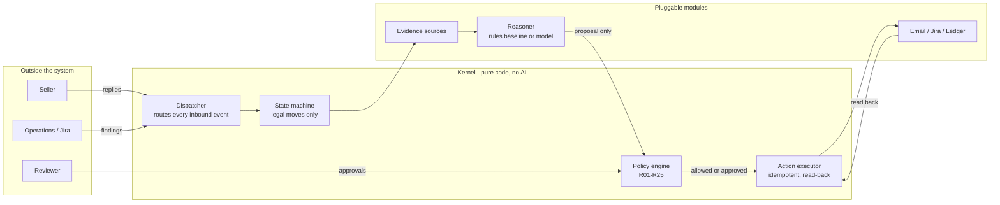

# Weight Dispute Resolution Agent

An action-taking agent that takes a shipping weight dispute - "the seller disagrees with a
charge" - to a verified outcome. It gathers evidence, recalculates the charge in code,
investigates, writes to the seller, opens Jira issues, asks a person to approve credits and
messages, posts credits to a simulated ledger, and reads every result back before it calls
anything done.

**Code owns every decision; the AI investigates and proposes.** The model can suggest "ask
the seller for a photo" or "this looks like a calculation error"; whether anything happens,
and for how much, is decided by deterministic code, policy rules and a person.

An independent portfolio project on synthetic data. Not connected to, or affiliated with, any
company's systems.

## Honest limits

Read this before any number below.

- **A synthetic pilot.** Every shipment, seller and charge is synthetic. Rates and limits are
  illustrative configuration, not any company's tariff. Email and Jira run as fakes unless the
  owner connects test accounts; the ledger is simulated.
- **Not ready for production use**, and not suitable for real sellers, money or mailboxes.
  The results do not show production readiness.
- **A person approves.** Every credit and, in the pilot, every message to a seller waits for
  a person's approval. The agent is not autonomous.
- **"Verified" means read back, not delivered.** A verified email is one found in the pilot
  mailbox's Sent Items with exactly the approved text - not one proven to have reached anyone.
- **Prompt injection.** No injection in the test corpus succeeded, by any of the four routes
  it can enter; money and messages also need code-proven facts and a person's approval. That
  is what was tested - not a guarantee against every possible attack.
- **No productivity claim.** Nothing here measures real operator time.
- **Cross-case patterns** (Phase 7) are hypotheses that can only add caution. They never prove
  fault.

## How it works



A case moves through a declared state machine (`docs/spec/transitions.yaml`); every move writes
an audit event with its cause. The model can only *propose*; the policy engine decides; the
executor is the only path to the outside world, and it verifies everything it does by reading it
back. Fifteen safety invariants (`CLAUDE.md` section 3) each have tests that try to break them.

Architecture: `docs/ARCHITECTURE.md`. Decisions: `docs/adr/`. Specifications: `docs/spec/`.

## Running it

```bash
make setup          # install with uv
make verify         # lint, types, architecture rules and every test
make eval           # the whole scenario suite, its gates, and a report in data/eval/
make demo ARGS="--offline calc_error_wrong_slab"   # one dispute end to end, offline
make run-api        # the API on the whole offline line (fakes, synthetic data)
make run-approvals  # the review console
```

Nothing above reaches the network or costs money. The model route (Microsoft Foundry, with a
Haiku failover) is off by default; `docs/SETUP_FOUNDRY.md` turns it on. Real Outlook and Jira
need the owner's test accounts (`docs/SETUP_CHANNELS.md`).

Walkthrough: `docs/DEMO.md`. Which modules are on and how to switch them: `docs/MODULES.md`.

## What the evaluation shows

`make eval` plays the scenario catalogue (`docs/spec/eval-scenarios.yaml`, 57 scenarios outside
Phase 7) on the whole line, with the model's choices fixed to the ones each scenario declares,
and enforces the release gates in `config/release_gates.yaml`. That run measures the system
around the model - policy, approvals, the executor, verification, timers - not the model.

Recorded run (57 scenarios, 1 run each): 57 of 57 scenarios passed every declared
expectation; across the 57, zero unauthorised credits, zero duplicate emails, issues or credits,
zero unknown outcomes marked resolved, and no injection in the 4 injection scenarios succeeded.
The gate thresholds were approved by the owner against these first measurements.

The model's own choices are measured separately by a live run (`make eval ARGS="--live"`); the
first one is recorded in `docs/evals/2026-11-04-live-gpt-5-mini.md`, with its sample size.

## Status

Phases 0 to 5 are complete; Phase 6 (evaluation and hardening) is in progress; Phase 7
(cross-case intelligence) is next. Progress and history: `docs/PROGRESS.md`. Open items:
`docs/BACKLOG.md`. How the project was built with Claude Code: `docs/BUILD_PACK.md`.
