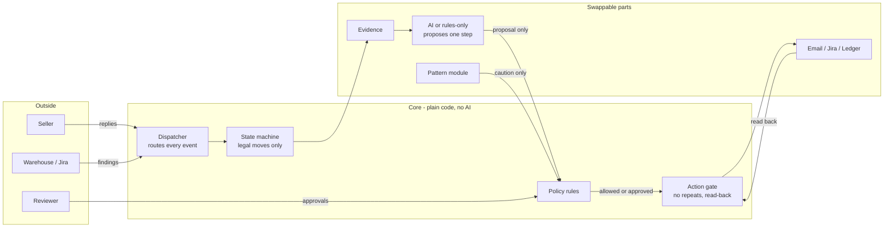

# Weight Dispute Resolution Agent

An AI agent that resolves shipping **weight disputes**. A seller disagrees with a weight charge; the agent takes the case from complaint to a checked outcome, and a person signs off every credit.

> An independent portfolio project on **synthetic data**. Not connected to, or affiliated with, any company's systems. Rates and limits are illustrative.

---

## In one minute

| | |
|---|---|
| **The problem** | Couriers bill by weight. Sellers often dispute the charge ("my kurta weighs 480 g, why was I billed for 2 kg?"). Each dispute is slow manual work: find the evidence, redo the arithmetic, write to the seller, chase the warehouse, decide, refund, record it. Mistakes cost money in both directions. |
| **What the agent does** | It gathers the evidence, recalculates the charge, works out the next step, drafts the email, raises warehouse tickets, posts approved credits, and checks that every action really happened. |
| **The key design choice** | **Code decides; the AI only proposes.** The AI reads the case and suggests one next step. Policy rules decide whether that step is allowed, and a person approves every credit and every email. |
| **What makes it safe** | Fifteen written safety rules. Each one has tests that actively try to break it. |
| **What makes it smart over time** | It spots patterns across disputes (for example, one scanner causing many complaints), opens one investigation for the warehouse team, and becomes more careful on matching cases. A pattern is never treated as proof. |

---

## Who is involved

| Who | What they do |
|---|---|
| **Seller** | Raises the dispute, answers questions, sends photos. |
| **Reviewer** (a person in the support team) | Approves or rejects every credit and every email in the review console. |
| **Operations / warehouse team** | Re-measures parcels and investigates repeated problems, through Jira tickets. |
| **The agent** | Does the legwork in between, and never acts without passing the safety checks. |

---

## One dispute, start to finish

A worked example from the test data, *"billed for a keyed weight"*:

> The seller is billed **INR 2,800** for shipment SHP-000002, charged at a weight of **20,000 g**. The parcel really weighs **7,000 g**. Someone typed the weight wrong.

| Step | What happens | Who decides | Case status |
|---|---|---|---|
| 1. **Dispute arrives** | The seller's form arrives. A duplicate submission is recognised as the same dispute, not a second case. | code | `RECEIVED` |
| 2. **Eligibility** | The shipment must have been delivered. If it wasn't (returned, cancelled, lost), the case closes politely with a reason. If the status is unknown, a person decides. | code | `GATHERING_EVIDENCE` |
| 3. **Evidence** | The declared size, the measured size and weight, the scanner, the zone, and the billing lines. Missing data is retried, never guessed. | code | `GATHERING_EVIDENCE` |
| 4. **Recalculation** | The billable weight is the larger of the real and the "volumetric" weight. Here that's 7,000 g = 14 weight bands × INR 70 = **INR 980**. Overcharge: **INR 1,820**. All money math is exact, in paise. | code only | `CALCULATING` |
| 5. **Investigation** | The AI (or, if the AI is off, a rules-only decision-maker) reads a briefing and proposes **one** next step: here, *"credit INR 1,820, reason: calculation error"*. | AI proposes | `INVESTIGATING` |
| 6. **Policy check** | About 25 rules check the proposal. Is the amount within limits? Was this shipment already credited? Is the reason one we allow? Is the kill switch off? Credits always need a person. | code | `AWAITING_APPROVAL` |
| 7. **Human approval** | The reviewer sees the amount, the evidence and the reason, and clicks approve. | **person** | `AWAITING_APPROVAL` |
| 8. **Action, then proof** | The credit is posted to the ledger, then **read back** from the ledger to confirm it really exists. | code | `EXECUTING` → `VERIFYING` |
| 9. **Tell the seller** | A confirmation email is drafted from fixed templates. Every number in it is checked against the calculation. A person approves the exact text. It is sent, then found in Sent Items with exactly that text. | person + code | `AWAITING_APPROVAL` → `VERIFYING` |
| 10. **Closed** | The case is credited and the seller has been told. It is handed to the pattern module to learn from. | code | **`RESOLVED_CREDITED`** |

Every step writes an audit entry: what changed, when and why. The case timeline page shows the whole history.

### Other ways a case can go

| Situation | What the agent does | Ends as |
|---|---|---|
| Not enough evidence | Emails the seller asking for specific items (after approval). Sends a reminder after **48 h**, and decides after **72 h**. | resolved, or `CLOSED_NO_RESPONSE` |
| Measurements disagree | Asks the warehouse to re-measure through a **Jira ticket**. A person takes over if there's no answer in **120 h**. | depends on the new measurement |
| The charge was correct | Explains why to the seller (after approval). | `RESOLVED_UPHELD` |
| Shipment not eligible | Says why. | `REJECTED_INELIGIBLE` |
| Seller withdraws | A free-text "I withdraw" is confirmed by a person first. | `WITHDRAWN` |
| Anything unclear or risky | Hands the case to a person, with the reason written down. | `NEEDS_HUMAN_REVIEW` |

The agent doesn't nag: at most **3 emails per case** and **1 per day**, and one clarification question before a person steps in.

---

## What the AI may and may not do

| The AI **may** | The AI **may not** |
|---|---|
| Read a briefing of the case (evidence, the code's calculation, the seller's words labelled as *untrusted*) | Send anything, credit anything or change any record. It has no access to those tools at all. |
| Propose one next step from a fixed menu, with its reasoning and the evidence it cites | Do arithmetic that reaches the seller. Every number comes from code. |
| Draft an email's wording from approved templates | Approve itself, change a limit, or skip a person |
| Read a seller's reply and say what it seems to mean | Treat text written by outsiders as instructions |
| Describe possible causes of a repeated problem | Accuse anyone, or credit or penalise anyone because of a pattern |

If the AI is unavailable, a **rules-only** decision-maker handles the clear cases and passes the rest to a person. The project runs fully this way by default, at no cost.

**How the AI is called:** through one guarded route (Microsoft Foundry, gpt-5-mini, with Claude Haiku as a backup), with spending caps per case and in total. Total AI spend during development was about **USD 0.66** against a USD 150 cap.

---

## Safety, in plain words

The fifteen rules ("invariants", in `CLAUDE.md`) come down to these promises:

1. **The AI never writes.** It can only suggest.
2. **Everything that touches the outside world goes through one gate**: policy check → a unique ID so it can never happen twice → do it → **read it back** to prove it.
3. **No credit without a person's approval**, within limits, and never twice for the same reason.
4. **"Unsure" goes to a person.** An outcome the system cannot confirm is never counted as a success.
5. **Outside text is data, not instructions.** Seller emails and notes can't change what the agent is allowed to do.
6. **A switched-off part never fails silently.** The case goes to a person, naming the missing part.
7. **Patterns can only make the agent more careful**, never less.
8. **Every status change is recorded with its cause.**
9. **Money and weight are calculated by code**, and every number in an email must match the calculation.
10. **A kill switch stops all outside actions instantly**, checked at the last moment before each one.
11. **Made-up data only**, and messages can only go to the owner's own test address.
12. **Secrets never appear** in the code, logs or prompts.

---

## Learning across disputes

Each closed case is handed to a **pattern module**. Every hour it looks for clusters, such as **3 or more disputes in 14 days** that share a scanner, a warehouse (hub), a product (SKU) or a seller. Finding clusters is plain counting, done by code; the AI is not involved.

| Step | Example: five disputes through scanner SCN-03-2 |
|---|---|
| Spot | One pattern is recorded as **unconfirmed**: "5 disputes share scanner SCN-03-2. This is a hypothesis, not a finding." |
| Investigate | One Jira investigation ticket goes to the warehouse team, through the same safety gate (checked by reading it back). Re-running the analysis never opens a second ticket. |
| Be careful | A new dispute through that scanner is shown the pattern, labelled as a hypothesis, and **must be approved by a person**. |
| Confirm or dismiss | **Only a structured finding from the warehouse team** changes a pattern's status. Cases that escalated *because of* the pattern never count as proof of it. |
| Watch | After a fix, the agent counts disputes before and after it. If they keep coming, the pattern is reopened automatically. |

---

## What's real and what's simulated

| Part | Status |
|---|---|
| Shipments, sellers, charges | **Synthetic.** Generated from a fixed seed, so every run is the same. |
| Ledger (where credits are posted) | **Simulated**, as an independent store that can fail in realistic ways. |
| Jira | **Real**: tested live against the owner's test project. A stand-in is used by default. |
| Email | **Stand-in mailbox** for now. Real Gmail (ADR 0038) and Outlook connectors are built; going live needs the owner's sign-in. |
| AI | **Real** when switched on (Microsoft Foundry); off by default. |
| Monitoring | Traces reach Azure Application Insights with **no message content**. |

---

## Evidence it works

| Check | Result |
|---|---|
| Automated tests | More than 3,200 pass on every change, on the owner's machine and on GitHub. |
| Scenario suite (`make eval`) | **57 of 57** scenarios pass. Across them: zero unapproved credits, zero duplicate emails, tickets or credits, zero unconfirmed outcomes counted as done, and no prompt injection succeeded in the 4 injection scenarios. |
| Release gates | All 12 recorded gates pass (`config/release_gates.yaml`). |
| AI choosing the right first step (live, 2026-11-04) | gpt-5-mini: **62% of 45** scenarios correct; rules-only baseline: **48% of 45**. Below the 90 percent bar the owner set, so the AI's instructions need more work (`docs/evals/2026-11-04-live-gpt-5-mini.md`). |
| Attack tests (live, local) | 0 of 24 injection attempts got through, by two routes (`docs/evals/2026-11-04-red-team-live.md`). |
| Pattern analyst AI (live) | Passed 6 of 6 under a rule set before the run (`docs/evals/2026-11-04-pattern-analyst-live.md`). |
| End to end on the running app | A dispute goes in over the web API, a person approves, and the case ends credited, confirmed and recorded. |
| Live Jira | The pattern job opened a real investigation ticket, confirmed it by reading it back, and made no duplicate on a second run. |

Building and testing it this way caught real bugs before any user could. For example, the running app couldn't send anything because of a database lock in the kill-switch check, and a duplicate check crashed on Jira's newer search. Each fix came with a test that would catch it again.

---

## Honest limits

- **A synthetic pilot.** Every shipment, seller and charge is synthetic, and rates and limits are illustrative. The results **do not show production readiness**, and the project is not suitable for real sellers, money or mailboxes.
- **A person approves.** Every credit and, in this pilot, every message to a seller waits for a person's approval. The agent is not autonomous.
- **"Verified" means read back, not delivered.** A verified email is one found in the mailbox's Sent Items with exactly the approved text, not one proven to have reached anyone.
- **Prompt injection.** No injection in the test set succeeded. Money and messages also need facts proven by code and a person's approval. That is what was tested, not a guarantee against every possible attack.
- **No productivity claim.** Nothing here measures real operator time.
- **Patterns are hypotheses.** They only add caution, and only a structured finding from operations confirms or dismisses one. The thresholds were set for synthetic data, not tuned on real disputes.
- **Sign-ins expire.** With a personal Google app in testing, the Gmail sign-in must be renewed every 7 days. Until then, cases go to a person instead of emails going out.
- **Runs on one machine.** It is not hosted. The review console is a local page.

---

## Try it

```bash
make setup          # install (uses uv)
make verify         # every check and test
make eval           # the 57 scenarios, the gates, and a report in data/eval/
make demo ARGS="--offline calc_error_wrong_slab"   # one dispute end to end, printed as a timeline
make run-api        # the web API and the background runner (offline: stand-ins, synthetic data)
make run-approvals  # the review console, where a person approves credits and emails
```

None of the commands above reaches the internet or costs money. To switch on the real AI see `docs/SETUP_FOUNDRY.md`, and for real Jira or email see `docs/SETUP_CHANNELS.md`.

---

## How it's built



- **The core** holds the rules: the case's states, policy and the action gate. It never imports a provider, a database library or an AI SDK.
- **Swappable parts** plug into fixed sockets. Each part can be switched on or off, and swapped (stand-in ↔ real) in `config/modules.yaml`.
- The pattern module was added at the end, into a socket designed at the start. An automated check proves that phase changed no line of the core.

---

## Glossary

| Term | Meaning |
|---|---|
| **Case** | One dispute, with its full history. |
| **State** | Where a case is (for example `AWAITING_APPROVAL`). It changes only through allowed moves. |
| **Proposal** | The one next step the AI (or the rules) suggests, with its reasons. |
| **Policy verdict** | The rules' answer to a proposal: allow, needs a person's approval, hand to a person, or refuse. |
| **Approval** | A person's yes, tied to the exact amount or text they saw. |
| **Action gate (executor)** | The only route to the outside world: check, act once, read back. |
| **Read-back** | Fetching what was just done (ledger entry, email, ticket) to prove it matches what was approved. |
| **Idempotency key** | A unique stamp on every action, so a retry can never do it twice. |
| **Kill switch** | One switch that stops all outside actions immediately. |
| **Pattern** | A repeated problem across disputes, held as a hypothesis until operations confirm it. |
| **Synthetic data** | Realistic but made-up data, safe to test with. |

---

## Read more

| If you want… | Read |
|---|---|
| A guided walkthrough | `docs/DEMO.md` |
| Which parts are on, and how to switch them | `docs/MODULES.md` |
| The architecture | `docs/ARCHITECTURE.md` |
| Why each decision was made | `docs/adr/` (38 decision records) |
| The detailed specifications | `docs/spec/` |
| Progress, history and open items | `docs/PROGRESS.md`, `docs/HANDOFF.md`, `docs/BACKLOG.md` |
| The safety review against known threats | `docs/SECURITY_REVIEW.md` |
| How it was built with Claude Code | `docs/BUILD_PACK.md` |

## Status

Phases 0 to 7 are built and approved, with all safety reviews done. Live today: the AI route (on demand), Jira and monitoring. Next: the Gmail sign-in, then the live email test. Possibly later: a hosted read-only demo using only synthetic data.
