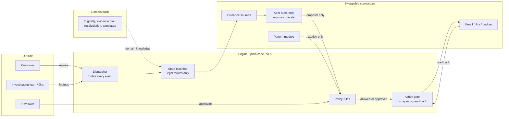

# Dispute Resolution Agent

An AI agent that takes a dispute from **"I disagree with this charge"** to a **checked, approved outcome**. It gathers evidence, recalculates in code, proposes the next step, gets a person's approval, acts in real systems (email, tickets, ledger) and proves each action happened by reading it back.

It is built as a **general engine with domain packs**. The first pack, **shipping weight disputes**, runs end to end.

> An independent portfolio project on **synthetic data**. Not connected to, or affiliated with, any company's systems. Rates and limits are illustrative.

---

## In one minute

| | |
|---|---|
| **The problem** | Every business that charges customers or partners gets disputes: "you billed me wrongly". Each one is slow, manual and risky: find the evidence, redo the maths, talk to the customer, ask an internal team to check, decide, refund, record. Errors leak money both ways and erode trust. |
| **What the agent does** | It runs the whole dispute workflow and connects to the real tools a team already uses (email, Jira, a ledger). People stay in control of every decision that matters. |
| **The key design choice** | **The AI investigates and proposes; code decides.** The AI works the case (it can open evidence in full, look up a policy rule and check its own draft) and suggests one next step. Policy rules decide whether that's allowed, and a person approves every refund and every message. |
| **What makes it safe** | Fifteen written safety rules, each with tests that actively try to break it. Every outside action is checked, done exactly once, and verified. |
| **What makes it learn** | It spots patterns across disputes (for example, one faulty scanner or one confusing fee), opens one investigation for the right team, and becomes more careful on matching cases. A pattern is never treated as proof. |
| **What's proven** | One domain (shipping weight disputes), end to end, on synthetic data, with real Jira and real AI calls. Results are in [Evidence it works](#evidence-it-works). |

---

## Disputes look the same everywhere

Strip away the industry and every billing dispute has the same anatomy:

| Industry | The complaint | Evidence | Recalculation | Remedy | Who investigates |
|---|---|---|---|---|---|
| **Logistics** (built) | "You charged my parcel at 2 kg; it weighs 480 g" | declared vs measured size and weight, scanner, zone, bill | billable weight, rate slabs | credit the difference | hub operations: re-measure, check the scanner |
| Marketplaces | "Wrong commission or fee on my order" | order, category, fee schedule, promotions | fee recomputation | fee reversal | category or finance ops |
| Telecom and utilities | "My bill is too high this month" | usage records, plan, meter reads | bill recomputation | bill adjustment | network or metering team |
| Payments | "I didn't get what I paid for" (chargeback) | transaction, delivery proof, merchant response | refund eligibility | refund or representment | risk and merchant ops |
| Insurance | "My claim was under-settled" | policy, claim documents, assessor report | payout recalculation | top-up payment | claims assessment |
| B2B and SaaS | "This invoice doesn't match our contract" | contract, usage, invoice lines | invoice recomputation | credit note | billing and account team |

In every row, the work is the same 8 steps: **take in the dispute, check eligibility, gather evidence, recalculate, decide the next step, get approval, act, then prove it and close.** That is what the engine does. The domain pack supplies what each row's columns mean.

---

## What's shared and what's per domain

| The engine (shared by every domain) | The domain pack (one per domain) |
|---|---|
| Case intake, de-duplication, full audit trail | What facts a dispute carries |
| A state machine: legal moves only, timers, reminders, timeouts | Who is eligible |
| Evidence gathering, with retries; missing data is never guessed | Which evidence to fetch, and from where |
| The AI investigator (or a rules-only fallback) | **The recalculation**, in exact code |
| Policy rules, human approval, the kill switch | Which actions are allowed at each point |
| One gate for every outside action: check, act once, read back | Message templates, limits, remedy reasons |
| Email, ticket and ledger connectors | Domain-specific rules (for example, a credit can't exceed what was billed) |
| Pattern detection across cases | Which attributes patterns group on (scanner, hub, product, seller, …) |

**Honest note on generality.** Only one pack exists. The pack socket is generic, but the core still uses some shipping words: cases carry a "shipment" and a "seller", and one allowed action is "request remeasurement". A second domain would first rename those to neutral terms (customer, item, "request re-check"). That is a recorded core change, estimated as small but not yet done. A product built for one domain and *designed* for many is what this is; a proven multi-domain platform is not.

---

## Domain pack 1: shipping weight disputes

### Why logistics teams will recognise this

Couriers bill on **chargeable weight**, the larger of the parcel's real (dead) weight and its **volumetric** weight (length × width × height ÷ a divisor), rounded up into weight slabs and priced by zone. The weight is captured at a hub, by a scanner or by hand, and that's where disputes come from:

- a **keyed error** (20,000 g typed for 7,000 g);
- a **scanner out of calibration** at one hub;
- a seller who **changed packaging** without updating the declared size;
- a box measured with a **strap or a second parcel** in the frame;
- a **duplicate charge** on the same shipment.

Sellers raise these in volume, and each one costs:
- support time;
- a hub re-measurement;
- a judgement call on evidence that's often thin, like a photo;
- a credit that must be right in both directions.

Undercredit and the seller's trust drops; overcredit and margin leaks. Worse, repeat causes (one scanner, one hub) hide inside thousands of individual tickets.

### One dispute, start to finish

A worked example from the test data, *"billed for a keyed weight"*:

> The seller is billed **INR 2,800** for shipment SHP-000002, charged at **20,000 g**. The parcel really weighs **7,000 g**.

| Step | What happens | Who decides | Case status |
|---|---|---|---|
| 1. **Dispute arrives** | The seller's form arrives. A duplicate submission is recognised as the same dispute. | code | `RECEIVED` |
| 2. **Eligibility** | Was the shipment delivered? If it was returned, cancelled or lost, the case closes politely with the reason. If the status is unknown, a person decides. | code | `GATHERING_EVIDENCE` |
| 3. **Evidence** | Declared size, measured size and weight, the scanner, the zone, the billing lines. Missing data is retried, never guessed. | code | `GATHERING_EVIDENCE` |
| 4. **Recalculation** | Billable weight is max(real, volumetric) = 7,000 g = 14 slabs × INR 70 = **INR 980**. Overcharge: **INR 1,820**. The maths is exact, in paise. | code only | `CALCULATING` |
| 5. **Investigation** | The AI (or the rules-only fallback) reads a briefing and proposes **one** next step: *"credit INR 1,820, reason: calculation error"*. | AI proposes | `INVESTIGATING` |
| 6. **Policy check** | About 25 rules: within limits? already credited? an allowed reason? kill switch off? A credit always needs a person. | code | `AWAITING_APPROVAL` |
| 7. **Human approval** | The reviewer sees the amount, the evidence and the reason, and approves. | **person** | `AWAITING_APPROVAL` |
| 8. **Action, then proof** | The credit is posted to the ledger, then **read back** to confirm it exists. | code | `EXECUTING` → `VERIFYING` |
| 9. **Tell the seller** | A confirmation is drafted from templates. Every number is checked against the calculation. A person approves the exact text. It's sent, then found in Sent Items. | person + code | `AWAITING_APPROVAL` → `VERIFYING` |
| 10. **Closed** | Credited and told. The case feeds the pattern module. | code | **`RESOLVED_CREDITED`** |

Every step writes an audit entry: what changed, when and why. The case timeline page shows it all.

### Other ways a case can go

| Situation | What the agent does | Ends as |
|---|---|---|
| Not enough evidence | Asks the seller for specific items (after approval). Reminder after **48 h**, decision after **72 h**. | resolved, or `CLOSED_NO_RESPONSE` |
| Measurements disagree | Raises a **Jira ticket** for the hub to re-measure. A person takes over after **120 h** without an answer. | depends on the re-measurement |
| The charge was right | Explains why (after approval). | `RESOLVED_UPHELD` |
| Shipment not eligible | Says why. | `REJECTED_INELIGIBLE` |
| Seller withdraws | A free-text "I withdraw" is confirmed by a person first. | `WITHDRAWN` |
| Anything unclear or risky | Hands the case to a person, with the reason written down. | `NEEDS_HUMAN_REVIEW` |

No nagging: at most **3 messages per case** and **1 per day**, and one clarifying question before a person steps in.

---

## What the AI may and may not do

| The AI **may** | The AI **may not** |
|---|---|
| Read a briefing: the evidence, code's calculation, and the customer's words labelled *untrusted* | Send, refund or change anything. It has no access to those tools at all. |
| Investigate in steps (agentic engine): open an evidence item in full, look up a policy rule, check its own draft against the same rules its decision will face | Use any tool that writes, take more than 4 steps, or spend past the case's AI call cap |
| Propose one next step from a fixed menu, with reasons and cited evidence | Produce a number the customer sees. Every number comes from code. |
| Draft a message's wording from approved templates, and choose requested evidence from a fixed, pre-worded list | Approve itself, change a limit, or skip a person |
| Interpret a customer's reply | Follow instructions hidden in a customer's text |
| Suggest possible causes of a repeated problem | Accuse anyone, or credit or penalise anyone because of a pattern |

If the AI is off or unavailable, a **rules-only** decision-maker resolves the clear cases and hands the rest to a person. The project runs this way by default, at no cost. When the AI is on, it goes through one guarded route (Microsoft Foundry, gpt-5-mini, with Claude Haiku as a backup) with spending caps per case and in total. Total AI spend during development was about **USD 0.66** against a **USD 150** cap.

---

## Safety, in plain words

The fifteen rules ("invariants", in `CLAUDE.md`) come down to these promises, for any domain:

1. **The AI never writes.** It only suggests.
2. **One gate for the outside world**: policy check → a unique stamp so it can never happen twice → act → **read it back** to prove it.
3. **No refund without a person's approval**, within limits, and never twice for the same reason.
4. **"Unsure" goes to a person.** An unconfirmed outcome is never counted as success.
5. **Outside text is data, not instructions.** A customer's email can't change what the agent may do.
6. **A switched-off part never fails silently.** The case goes to a person, naming what's missing.
7. **Patterns only make the agent more careful.**
8. **Every status change is recorded with its cause.**
9. **Money is calculated by code**, and every number in a message must match.
10. **A kill switch stops all outside actions at once**, checked at the last moment before each one.
11. **Made-up data only**, and messages can only go to the owner's own test address.
12. **Secrets never appear** in the code, logs or prompts.

---

## Learning across disputes

Each closed case feeds a **pattern module**. Every hour it looks for clusters, such as **3 or more disputes in 14 days** sharing one attribute. In the shipping pack those attributes are a scanner, a hub, a product (SKU) or a seller; another domain would use its own (a plan, a region, a merchant category). Clustering is plain counting, done in code.

| Step | Example: five disputes through one scanner |
|---|---|
| Spot | A pattern is recorded as **unconfirmed**: *"5 disputes share scanner SCN-03-2. A hypothesis, not a finding."* |
| Investigate | **One** Jira investigation goes to the hub team, through the same safety gate and checked by reading it back. Re-running never opens a second ticket. |
| Be careful | A new dispute through that scanner is shown the pattern, labelled a hypothesis, and **needs a person's approval**. |
| Confirm or dismiss | **Only a structured finding from the team** changes the status. Cases that escalated *because of* the pattern never count as proof. |
| Watch | After a fix, disputes are counted before and after. If they continue, the pattern reopens automatically. |

This is where the product moves from *resolving* disputes to **reducing** them: the root cause reaches the team that can fix it.

---

## Questions worth debating

Points a PM should push on before taking this further:

- **How much human approval is right?** Today every refund *and* every message is approved by a person. That's safe, but it costs reviewer time at volume. Which message types could send automatically, and on what evidence? (Open decision O7; the design supports switching by message type.)
- **What does success mean?** This pilot measures correctness on synthetic scenarios, not business impact. In production you'd track:
  - time to resolution;
  - credit accuracy, both wrongful credits and missed credits;
  - reopen rate;
  - repeat disputes per root cause;
  - reviewer load per case;
  - customer satisfaction after resolution.

  None of these is measured here.
- **Is the AI worth it over rules, and can we even tell yet?** The first live test scored the AI at 62% of 45 scenarios, against 48% of 45 for rules. But a rerun a day later scored 24% of 45, with nothing changed. The 45 scenarios rest on only 13 distinct disputes, and one dispute decides 29 of them, so one coin-flip moves the score by tens of points. Before choosing better instructions, a better model or narrower AI scope, the measurement itself needs fixing: score per dispute, over repeated runs (`docs/evals/2026-11-05-langgraph-vs-single.md`).
- **Fairness.** A pattern must never become a penalty. Could a hub cluster bias decisions against the sellers who ship through it? Here patterns only add caution, never a decision. Is that enough?
- **Gaming.** Once customers learn what earns a credit, the evidence they send will change. The design treats all customer text as untrusted and makes code prove every number. What else is needed?
- **Systems of record.** Read-back proves the ledger, mailbox or ticket says what we did. In a real company, which system is the source of truth for a credit, and who reconciles it?
- **Cost per case.** AI calls are capped and logged per case. At what dispute value is the AI step not worth its cost?

---

## How the agent frameworks are used

Each tool was picked for a job, and the safety rules apply to all of them.

| Framework | Its job here | In PM terms | Safety boundary |
|---|---|---|---|
| **Custom loop** (the engine) | Runs every case over days: state machine, policy rules, action gate | The decision-maker. The AI investigates and proposes; code decides. Kept custom on purpose: no framework is allowed to call write tools on the model's behalf. | Fifteen invariants, each with tests that try to break them |
| **Custom agent loop** (the agentic investigator) | Works one case in steps (`REASONING_ENGINE=agent`) | Instead of answering once, the AI picks its own lookups: open a piece of evidence in full, read a policy rule, check its draft. Then it decides. Like an analyst who pulls the file before signing off. | Read-only tools only (evidence already gathered, local policy index). At most 4 steps, the case's usual call cap, every call through the guarded gateway. Its decision faces the same checks and policy as before. Off by default (ADR 0042) |
| **Claude Agent SDK** | The **Case Explainer** (`make explain`) | A reviewer asks *"why did this case go to a person?"* and an assistant reads the case history and answers, citing its sources. | Four read-only tools. The database is opened read-only, so SQLite itself refuses writes. No built-in tools; anything else is denied; Haiku only; capped spend (ADR 0039) |
| **LlamaIndex** | **Policy lookup** for the Explainer | Finds the exact rule or decision record behind an answer, so "R16" becomes a sentence a new reviewer understands. | Local keyword search (BM25): no AI, no cost, no network; project documents only (ADR 0040) |
| **LangGraph** | An experimental **two-pass investigator** (`REASONING_ENGINE=graph`) | Asks the AI twice. If the two answers disagree, the more cautious one wins and a person decides. A model that disagrees with itself shouldn't decide. | Still only proposes. Every AI call goes through the guarded gateway. Never less cautious than either pass (property-tested). Off by default (ADR 0041) |
| **Claude Code** | How the whole product was built | Design, code, tests, reviews and documentation | – |

**What measuring LangGraph taught us.** Both engines pass all 57 recorded scenarios. The live comparison was inconclusive: it showed the live test rests on 13 disputes, not 45 independent decisions. Measuring before adopting is the point. The two-pass engine stays off until a better-designed test shows it helps.

**Where the agency sits, and why.** The agent already runs multi-day cases on its own: it gathers evidence, writes to the customer, reads replies, raises tickets and posts credits, all through one gate. The agentic investigator adds the missing piece inside a decision: the AI chooses what to look at before it commits. It does **not** gain any power to act. For a workflow that moves money, the AI's freedom stops at gathering information and correcting itself. Every action still passes policy and, for money and messages, a person. The first live check showed the mechanism works safely (every dispute decided validly), but the AI rarely chose to look anything up, so it isn't more accurate yet. That is prompt work, measured per dispute.

---

## The operations console

Four screens over the running system (`make run-console`, beside `make run-api`), styled with the Hallmark design skill's Coral theme (ADR 0044):

| Screen | Who | What it does |
|---|---|---|
| **Raise a ticket** | Seller | Shows the seller's shipments and bills, raises a dispute through the same route as the dispute form, and tracks their tickets. |
| **Agent steps** | Anyone | Tells one case step by step, saying who did each step (code, AI, rules, a person, the seller, the hub): the evidence found and missing, code's recalculation, the AI's proposal and reasoning, policy's verdict, approvals, actions and the read-back that proved them. It refreshes live while the case is open. |
| **Review** | The human in the loop | Shows the AI's recommendation beside exactly what will happen on approval, with every number's source. Approve or reject; cases handed to a person are listed with the reason. |
| **Ledger** | Finance | Lists a seller's charges and credits. Each credit is traced to its case, who approved it, and whether it was proved by reading it back. |

The console writes nothing of its own. A ticket goes through the API and a decision through the review console's own rules, and the AI's words are always shown as plain text.

It can also be **hosted live** on Streamlit Community Cloud, sending real email and opening real Jira issues behind one password (ADR 0045, `docs/DEPLOY_STREAMLIT.md`).

---

## What's real and what's simulated

| Part | Status |
|---|---|
| Disputes, customers, charges | **Synthetic.** Generated from a fixed seed, so every run is identical. |
| Ledger (where credits are posted) | **Simulated**, as an independent store that can fail in realistic ways. |
| Jira | **Real**: tested live against the owner's test project. A stand-in is used by default. |
| Email | **Real Gmail**: tested live through the owner's test Gmail, sending only to the owner's own test address. A stand-in is used by default. An Outlook connector is also built, not yet live. |
| AI | **Real** when switched on (Microsoft Foundry); off by default. The Case Explainer uses Claude Haiku directly, read-only. |
| Monitoring | Traces reach Azure Application Insights with **no message content**. |

---

## Evidence it works

| Check | Result |
|---|---|
| Automated tests | More than 3,200 pass on every change, on the owner's machine and on GitHub. |
| Scenario suite (`make eval`) | **57 of 57** scenarios pass. Across them: zero unapproved credits, zero duplicate emails, tickets or credits, zero unconfirmed outcomes counted as done, and no prompt injection succeeded in the 4 injection scenarios. |
| Release gates | All 12 recorded gates pass (`config/release_gates.yaml`). |
| AI choosing the right first step (live) | gpt-5-mini: 62% of 45 (2026-11-04), then 24% of 45 on an identical rerun (2026-11-05); rules only: 48% of 45. Both runs are below the 90 percent bar. **Caution:** the 45 scenarios rest on 13 distinct disputes, so these scores swing widely. Treat them as unsettled, not as a measured level. |
| LangGraph two-pass investigator vs single call | Recorded suite: both 57 of 57. Live: 58% of 45 vs 24% of 45 on the same day, which is **inconclusive** for the same reason. It stays off by default (`docs/evals/2026-11-05-langgraph-vs-single.md`). |
| Agentic investigator | Recorded suite: 57 of 57 with it on and off. Live, per distinct dispute (gpt-5-mini, USD 0.13): passed its pre-set rule, with all 11 decided validly. It checked its own draft on 2 disputes and got both right; on the other 9 it decided at once. Right first step: single call 6 of 11, agent 5 of 11, one run each, so too few to separate them. Off by default (ADR 0042). |
| Case Explainer (live check) | 3 of 3 answers named the real reason, cited a source and recommended no decision, for USD 0.003. |
| Attack tests (live, local) | 0 of 24 injection attempts got through, by two routes (`docs/evals/2026-11-04-red-team-live.md`). |
| Pattern analyst AI (live) | Passed 6 of 6 under a rule fixed before the run (`docs/evals/2026-11-04-pattern-analyst-live.md`). |
| End to end on the running app | A dispute goes in over the web API, a person approves, and the case ends credited, confirmed and recorded. |
| Live Jira | The pattern job opened a real investigation ticket, confirmed it by reading it back, and made no duplicate on a second run. |
| Live Gmail | A whole dispute ran through real Gmail (`scripts/demo.py` without `--offline`): credit approved and posted, confirmation email sent, found in Sent, checked against the approved text, and the case closed as credited. One email, to the owner's own test address. |

Building it this way caught real bugs before any user could. For example, the running app couldn't send anything because of a database lock in the kill-switch check, and a duplicate check crashed on Jira's newer search. Each fix came with a test that would catch it again.

---

## Honest limits

- **A synthetic pilot.** All data is synthetic and every rate and limit is illustrative. The results **do not show production readiness**, and the project is not suitable for real customers, money or mailboxes.
- **One domain.** Only the shipping pack exists. The engine is designed to generalise, but a second domain needs some core names made neutral first (see [What's shared and what's per domain](#whats-shared-and-whats-per-domain)).
- **A person approves.** Every credit and, in this pilot, every message waits for a person's approval. The agent is not autonomous.
- **"Verified" means read back, not delivered.** A verified email is one found in the mailbox's Sent Items with exactly the approved text, not one proven to have reached anyone.
- **Prompt injection.** No injection in the test set succeeded. Money and messages also need facts proven by code and a person's approval. That is what was tested, not a guarantee against every possible attack.
- **No productivity claim.** Nothing here measures real operator time.
- **Patterns are hypotheses.** They only add caution, and only a structured finding from the right team confirms or dismisses one. The thresholds were set for synthetic data, not tuned on real disputes.
- **Sign-ins expire.** With a personal Google app in testing, the Gmail sign-in must be renewed every 7 days. Until then, cases go to a person instead of emails going out.
- **Runs on one machine.** It is not hosted. The review console is a local page.

---

## Try it

```bash
make setup          # install (uses uv)
make verify         # every check and test
make eval           # the 57 scenarios, the gates, and a report in data/eval/
make demo ARGS="--offline calc_error_wrong_slab"   # one dispute end to end, printed as a timeline
make run-api        # the web API and the background runner (offline: stand-ins, synthetic data)
make run-approvals  # the review console, where a person approves credits and messages
make run-console    # the four-screen operations console (seller, agent steps, review, ledger)
make explain ARGS="<case_id> <question>"   # ask the read-only Case Explainer (Haiku; a fraction of a cent)
```

None of the commands above reaches the internet or costs money, except `make explain`, which calls Claude Haiku within a capped budget. To switch on the real AI see `docs/SETUP_FOUNDRY.md`, and for real Jira or email see `docs/SETUP_CHANNELS.md`.

---

## How it's built



- **The engine** holds the workflow: the case's states, the policy rules and the action gate. It never imports a provider, a database library or an AI SDK.
- **Domain packs** hold the industry knowledge (`packs/weight_dispute/`).
- **Connectors** plug into fixed sockets, and each can be switched on or off, or swapped (stand-in ↔ real), in `config/modules.yaml`.
- The pattern module was added at the end, into a socket designed at the start. An automated check proves that phase changed no line of the engine.

---

## Glossary

| Term | Meaning |
|---|---|
| **Case** | One dispute, with its full history. |
| **Domain pack** | The industry-specific part: eligibility, evidence, recalculation, actions, templates. |
| **State** | Where a case is (for example `AWAITING_APPROVAL`). It changes only through allowed moves. |
| **Proposal** | The one next step the AI (or the rules) suggests, with reasons. |
| **Policy verdict** | The rules' answer: allow, needs a person's approval, hand to a person, or refuse. |
| **Approval** | A person's yes, tied to the exact amount or text they saw. |
| **Action gate (executor)** | The only route to the outside world: check, act once, read back. |
| **Read-back** | Fetching what was just done (ledger entry, email, ticket) to prove it matches what was approved. |
| **Idempotency key** | A unique stamp on every action, so a retry can never do it twice. |
| **Kill switch** | One switch that stops all outside actions immediately. |
| **Pattern** | A repeated problem across disputes, held as a hypothesis until the right team confirms it. |
| **Synthetic data** | Realistic but made-up data, safe to test with. |

---

## Read more

| If you want… | Read |
|---|---|
| A guided walkthrough | `docs/DEMO.md` |
| Which parts are on, and how to switch them | `docs/MODULES.md` |
| The architecture | `docs/ARCHITECTURE.md` |
| Why each decision was made | `docs/adr/` (45 decision records) |
| The detailed specifications | `docs/spec/` |
| Progress, history and open items | `docs/PROGRESS.md`, `docs/HANDOFF.md`, `docs/BACKLOG.md` |
| The safety review against known threats | `docs/SECURITY_REVIEW.md` |
| How it was built with Claude Code | `docs/BUILD_PACK.md` |

## Status

The engine and its first domain pack are built and approved through Phase 7, with all safety reviews done. Live today: the AI route (on demand), Jira, Gmail and monitoring. Possible next steps: a second domain pack (after making the core's names neutral), and a hosted read-only demo using only synthetic data.
