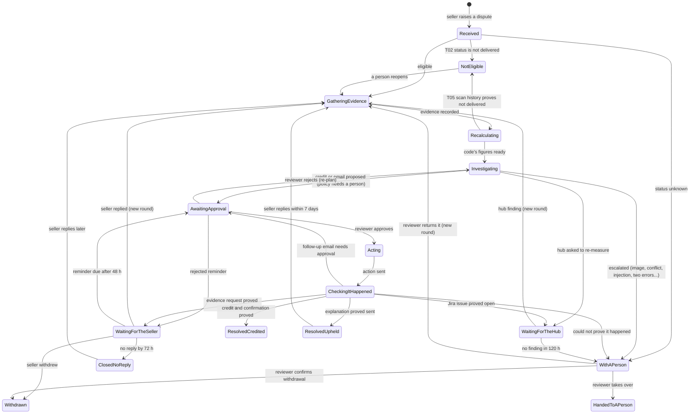
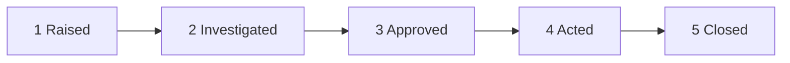
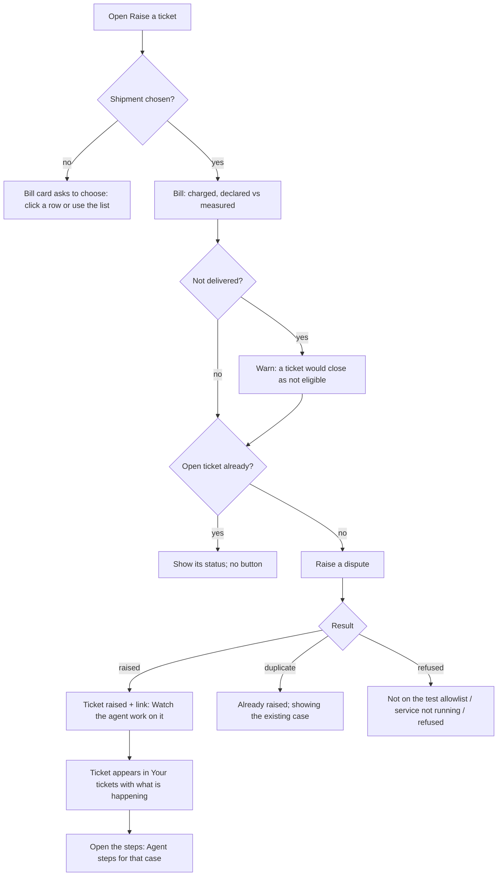
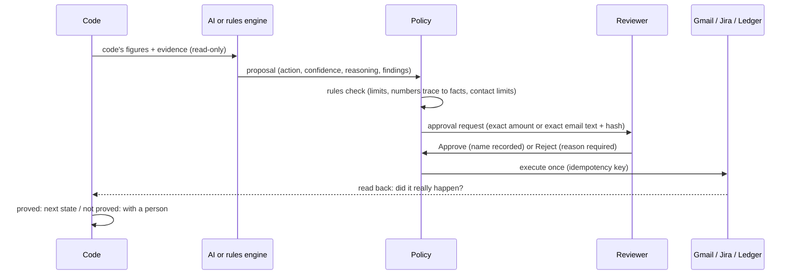
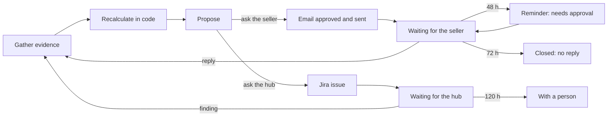
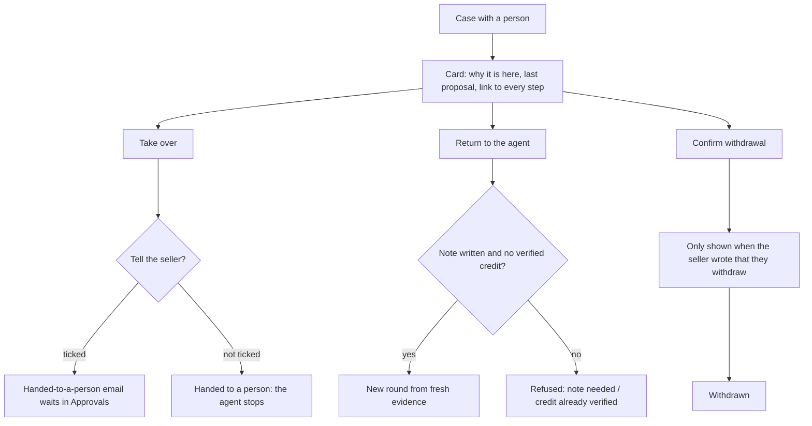
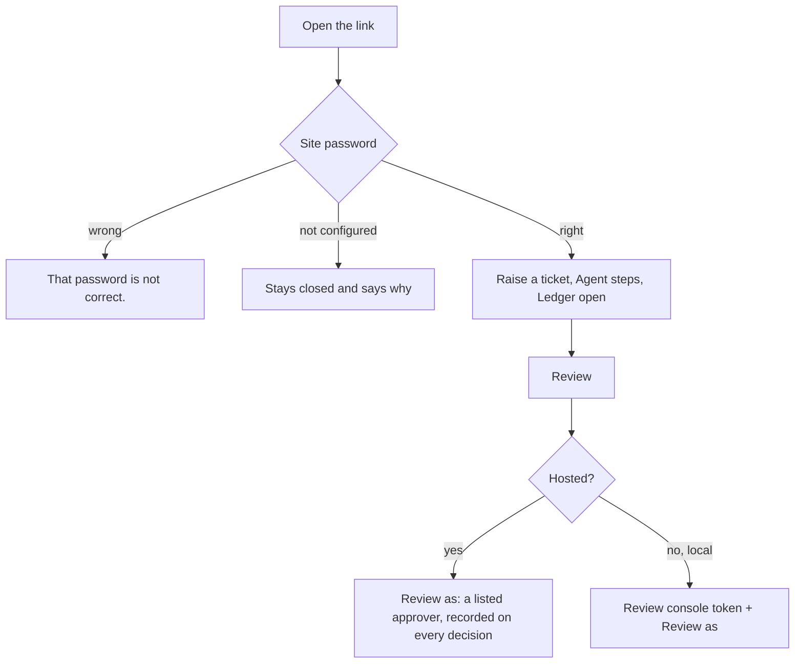
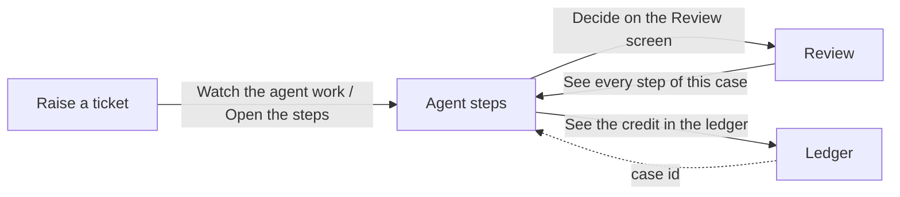

# Claude Design brief: Dispute Desk

The operations console for an AI agent that resolves shipping weight disputes.

**The design pack has three files:**

| File | What it is | Use it for |
|---|---|---|
| `CLAUDE_DESIGN_BRIEF.md` (this file) | Every user, use case, process flow, screen, state, label and rule | **What** the design must do |
| `SCREENS.pdf` | 20 screenshots of the console as built today, in every important state, desktop and phone | **What exists now**: improve on it, keep what works |
| `CLAUDE_DESIGN_PROMPT.md` | The prompt to paste into Claude Design | Starting the session |

This supersedes `FRONTEND_BRIEF.md`, which was written before the UX pass and ADR 0047.

**Design system:** Hallmark (github.com/Nutlope/hallmark), Coral theme, app-screen scope (§11).

**Output wanted:** a clickable, high-fidelity prototype of the five surfaces in §7 (gate plus four screens). It should cover:
- every state in §8;
- desktop (1440) and phone (375);
- the sample data in §10.

---

## 1. The product in one minute

A seller is billed for a parcel at the wrong weight (say 20 kg instead of 7 kg) and disputes the charge. An **AI agent** takes the dispute from complaint to a checked, approved, proven outcome:

1. **Checks** the dispute can be raised. Only delivered shipments can be disputed.
2. **Gathers** the evidence: the declared size, the hub's measurement, the billing entries, the parcel photo and earlier shipments of the same item.
3. **Recalculates** the charge **in code**, never in the AI.
4. **Proposes** one next step. This is done by the AI or, when it is off, a rules engine: credit the seller, uphold the charge, ask the seller for evidence, ask the hub to re-measure, or hand to a person.
5. **Gets a person's approval** for anything that touches money or the seller (every credit, every email).
6. **Acts** in real systems: Gmail, Jira, and a simulated ledger.
7. **Proves** each action happened by reading it back.

> **The one idea the design must make visible: the AI investigates and proposes. Code decides the numbers. A person approves anything that touches money or a customer. Every step says who did it.**

All data is synthetic: 14 made-up shipments, one seller (SELL-0001), and amounts in Indian rupees (₹). The console is live at disputeresolutionagent.streamlit.app, behind a password.

---

## 2. Design principles, in priority order

They are drawn from research on activity timelines, human-in-the-loop approval screens and the ui-ux-pro-max and Hallmark rule sets.

1. **Where is it, why, and what's next: in one glance.** Every case answers these three questions before anything else.
2. **Show who did what.** Seller, code, AI or rules engine, reviewer, hub or system. The difference between *code* and *AI* is the product's point, so make it visible.
3. **Approval is an informed act, not a rubber stamp.** Put what the agent recommends, its reasoning and its sources **next to** exactly what will happen on approval: the exact amount, or the exact email text and recipient. A bare "Approve" invites rubber-stamping.
4. **Progressive disclosure.** Lead with one line per step. Fold the detail. Show the AI's reasoning openly, because it is what people come to see.
5. **Honest and specific.** No invented metrics, no decorative charts, no "AI magic" language. Every figure traces to a record.
6. **A calm working tool, not a landing page.** Familiar patterns win: top bar, tabs, tables, cards, a stepper and a timeline. Dense where it helps, quiet elsewhere.
7. **Plain words over codes.** Internal codes (B3, `f_charged`, `evi_…`, `case_01M…`, `txn_…`) belong in the details, never in the first line a person reads.

---

## 3. Users, their jobs and their access

| User | Job to be done | Gets in with | Must never be able to |
|---|---|---|---|
| **Visitor** | Get into the app | The **site password** (one shared password, hosted) | See any screen without it |
| **Seller** | "I was overcharged; get it fixed and tell me where it stands" | Site password | See the "correct" charge before the agent works it out; type free text (a seller's words are untrusted input to the AI) |
| **Observer** (recruiter, PM, auditor) | "Show me how the agent thinks, step by step, and why" | Site password | Change anything |
| **Reviewer** (human in the loop) | "Approve or reject what the agent wants to do; handle what it handed over" | Hosted: site password, then they **choose a listed approver** to review as (ADR 0047). Run locally: the **review console token**, then the same choice | Approve something different from what they saw; act without their name being recorded |
| **Finance** | "What did this seller pay, what did we credit back, and can I trust each credit?" | Site password | Edit the ledger |

---

## 4. Process flows

### 4.1 The dispute lifecycle (every case state)



**Labels shown to people.** Use these exact words; §9.1 gives the tones.

| State | Label |
|---|---|
| Received | Received |
| GatheringEvidence | Gathering evidence |
| Recalculating | Recalculating |
| Investigating | Investigating |
| AwaitingApproval | Awaiting approval |
| WaitingForTheSeller | Waiting for the seller |
| WaitingForTheHub | Waiting for the hub |
| Acting | Acting |
| CheckingItHappened | Checking it happened |
| WithAPerson | With a person |
| HandedToAPerson | Handed to a person |
| ResolvedCredited | Resolved: credited |
| ResolvedUpheld | Resolved: charge upheld |
| Withdrawn | Withdrawn |
| ClosedNoReply | Closed: no reply |
| NotEligible | Not eligible |

**Any working state can go to *With a person*** when something unsafe happens: a module is off, the kill switch is on, the AI's output is invalid, the spend cap is reached, or an action failed.

### 4.2 The five phases a person sees (the stepper)

The 16 states fold into five phases. The stepper is the "how far along" answer.



| Mark | When | Words shown |
|---|---|---|
| done | the phase happened | done |
| in progress | the agent is working in this phase | in progress |
| waiting | paused on the seller, the hub or a reviewer | waiting |
| with a person | handed to a human in this phase | with a person |
| not needed | closed case: a later phase happened without this one (for example, an upheld case needed no credit approval) | not needed |
| not reached | closed case: it ended before this phase (for example, a not-eligible case never reached approval) | not reached |
| later | open case: not there yet | later |

On a credited case, *Closed* takes the coral settled colour. Every mark carries **words**, never colour alone.

### 4.3 Seller journey (Raise a ticket)



### 4.4 The approval flow (human in the loop)



**Design consequences:**
- **What the reviewer sees is what gets approved.** The approval is bound to a hash of the exact text. If the stored text changed, the card refuses to approve: *"The stored text has changed since approval was requested. It cannot be approved. Report this."*
- **Approvals expire after 72 h.**
- **A case allows at most 2 rejections**, then it goes to a person.
- **The page never sends anything.** It records the decision, and the agent picks it up within seconds. Say so: *"Recorded. The agent picks it up from here."*

### 4.5 The evidence loop (rounds)



Each pass is a **round**, titled by what started it: *First look*, *After the seller replied*, *After the hub's finding*, *After a deadline passed* and *After a person returned it*. The timeline groups steps by round.

### 4.6 The "with a person" desk



### 4.7 Not-eligible paths

| Path | When | What the person sees |
|---|---|---|
| **T02, at intake** | The shipment's status says it was not delivered (for example "Returned to origin") | Step 2 reads *"Checked eligibility: not eligible"*. Approved and Acted are *not reached*. |
| **T05, after the evidence** | The status said delivered, but the scan history proves it was not | Step 2 reads *"eligible"*. A later step reads *"Closed: not eligible"*, with the reason. Investigated is done; Approved and Acted are *not reached*. **No figures are shown**, because there is no overcharge question to answer. |

The seller is warned **before** raising a ticket on a shipment that is not delivered.

### 4.8 Getting in



### 4.9 How the screens connect



The selected case lives in the URL (`/steps?case=…`), so any case view can be shared and reloaded.

---

## 5. Use-case catalogue

UC numbers are stable. **P** is priority: 1 is a must for the prototype, 2 should be covered, 3 is if time allows.

### Seller

| UC | P | Use case | Success looks like |
|---|---|---|---|
| UC-1 | 1 | Dispute a wrongly billed parcel | Chooses the shipment (row click or list), sees the bill, raises. Sees "Ticket raised" and a link to watch the agent; the ticket appears with a sentence saying what's happening. |
| UC-2 | 1 | Track my tickets | One table shows each ticket's status and **what is happening** in a sentence, plus opened and last update. One click opens the agent's steps. |
| UC-3 | 2 | Avoid a pointless dispute | Choosing a not-delivered shipment warns before raising that it would close as not eligible. |
| UC-4 | 2 | Don't duplicate | A shipment with an open ticket shows that ticket's status and no button. Raising twice says *"already raised; showing the existing case"*. |
| UC-5 | 2 | Understand a refusal | Not on the allowlist, service not running, or refused: one plain sentence and what to do next. |
| UC-6 | 3 | Use it on a phone | The table scrolls inside its frame, the bill card follows, and the button is reachable. |

### Observer (Agent steps)

| UC | P | Use case | Success looks like |
|---|---|---|---|
| UC-7 | 1 | Know where a case is, why, and what's next | Header (shipment, status, seller, opened/closed, AI calls), then the headline, **Why** and **Next**, all above the fold. |
| UC-8 | 1 | See how far along it is | A five-phase stepper with words. |
| UC-9 | 1 | Follow what happened | A timeline grouped by round: each step has a number, a title, a one-line summary, who did it and when; details fold away. |
| UC-10 | 1 | See *why* a case went to a person | The Why line names the reason in words, and the step that escalated it is marked "Needs a person". |
| UC-11 | 1 | Read the AI's reasoning | Shown openly as a quote, labelled "exactly as recorded", with the model and instructions version (or "Rules engine (the AI was off or not needed)"). |
| UC-12 | 2 | Follow a multi-round case | Round 1: First look → evidence request → seller reply → Round 2 → hub re-measure (Jira) → Round 3 → credit. |
| UC-13 | 2 | Understand a not-eligible case | Both paths in §4.7 read without contradiction. |
| UC-14 | 2 | Watch a live case | An open case refreshes itself (every 4 s), and says so quietly. |
| UC-15 | 2 | Act on what I see | "Decide on the Review screen" when a person must act; "See the credit in the ledger" when credited. |
| UC-16 | 3 | See the cost of the AI | "3 AI calls (USD 0.0186)" or "no AI calls". |
| UC-17 | 3 | See that injected text was harmless | A case where the seller's text tried to instruct the agent shows it was treated as data and escalated. |

### Reviewer (Review)

| UC | P | Use case | Success looks like |
|---|---|---|---|
| UC-18 | 1 | Get in | Hosted: past the site password, choose a listed approver ("Review as"). Local: token, then the same choice. The approver shows after sign-in. |
| UC-19 | 1 | Know my queue | One line, for example *"2 waiting for your decision: a ₹152.00 credit, 1 email. 2 cases with a person."*, then two tabs with counts. |
| UC-20 | 1 | Approve a credit, informed | **What the agent recommends** (action, confidence, who proposed, reasoning, findings) **beside** **If you approve** (the exact amount, its reason, how code derived it, code's figures). The note is optional; Approve is primary. |
| UC-21 | 1 | Approve an email, informed | Recipient, subject and the full body as written, plus **every number in it and where it came from**. |
| UC-22 | 1 | Reject with a reason | A reason is required; the agent re-plans. After two rejections the case goes to a person. |
| UC-23 | 1 | Take over a case with a person | Why it is here, the last proposal, a link to every step; Take over, optionally telling the seller (that email itself waits for approval). |
| UC-24 | 2 | Return a case to the agent | A note is required. It is refused, with a reason, if a credit is already verified. |
| UC-25 | 2 | Confirm a withdrawal | Shown only when the seller wrote that they withdraw. |
| UC-26 | 2 | Be protected from a tampered draft | The integrity error replaces the buttons. |
| UC-27 | 3 | Review on a phone | The two columns stack (recommendation first); the decision stays at the foot of the card. |

### Finance (Ledger)

| UC | P | Use case | Success looks like |
|---|---|---|---|
| UC-28 | 1 | See a seller's position | Charged, Credited back and Net billed, each a sum of the rows. |
| UC-29 | 1 | Trust each credit | "Credits from disputes" shows posted, shipment, amount, reason, **approved by**, **proved (read back)** and case. |
| UC-30 | 2 | Find entries | All entries, filterable: All, Charges, Credits. |
| UC-31 | 3 | Spot a credit not posted by the agent | It reads "Not posted by the agent". |

---

## 6. Global layout and navigation

- **Top bar** (only four destinations, so no sidebar):
  - the wordmark **"Dispute desk"** on the left;
  - tabs **Raise a ticket**, **Agent steps**, **Review**, **Ledger**, with outline icons (receipt, route, checklist, bank), never emoji;
  - the active tab highlighted.
- **One content width**, about 1200 px (76 rem), centred.
- **Phone:** the tabs collapse into a menu or scroll; layouts stack.
- **Page title:** one h1 per screen, at a page-head size (not a display head).
- **Times:** one format everywhere: **"7 Nov 2026, 16:08 UTC"**. Inside one case's timeline, the time alone ("16:08") is enough when it is the same day.
- **Money:** one format everywhere: **₹1,820.00**. Never "INR 1820.00".

---

## 7. Screens

### Screen 0: Site password gate

- **Content:**
  - the title "Dispute desk";
  - one sentence: *"A live dispute resolution agent on synthetic data. It sends real email to a test address and opens real Jira issues in a test project, so it is behind a password."*;
  - a password field and an **Enter** button.
- **States:**
  - **Default.**
  - **Wrong password:** *"That password is not correct."*
  - **Not configured** (fails closed, no form): *"This hosted console has no password set (CONSOLE_PASSWORD), so it stays closed. It sends real email and opens real Jira issues."*
  - **Service failed to start:** *"The dispute service could not start: <which setting is missing>"*. It never shows a secret.

### Screen 1: Raise a ticket (seller). PDF shots 1–4.

- **Header:** "Raise a ticket". Sub-line: *"Signed in as seller SELL-0001. Every shipment here is synthetic; emails about your tickets go to the test seller address."*
- **Desktop layout:** two columns, the shipments table (3/5) and the **bill card** (2/5). "Your tickets" is full width below.
- **Your shipments** (table; clicking a row selects it): Shipment, Status (Delivered or Returned to origin), Zone, Charged and **Your ticket** (open ticket status, or blank). Helper: *"Click a row to see its bill."*
- **Dispute a charge** (the bill card, the screen's main object):
  - a Shipment selector (placeholder *"Choose a shipment"*);
  - once chosen: *"Charged for zone B"*, the **₹152.00** figure, then a definition list: **You declared** 20 x 15 x 10 cm, 0.48 kg · **The hub measured** 30 x 22 x 15 cm, 1.10 kg;
  - not delivered: a warning line, *"Its status is "Returned to origin", not delivered. Only delivered shipments can be disputed, so a ticket on it would close as not eligible."*;
  - **one primary action: "Raise a dispute".**
  - **After raising**, one line, not a boxed alert inside the card:
    - *"Ticket raised. The agent has started on it."* plus the link **Watch the agent work on it**;
    - *"This ticket was already raised; showing the existing case."*;
    - *"This seller address is not on the test allowlist."*;
    - *"The dispute service is not running…"*;
    - *"The dispute service refused the ticket (HTTP n)."*
  - **Open ticket exists:** *"You already have an open ticket on this shipment:"* and its chip. No button.
- **Your tickets** (table): Shipment, Status, **What is happening** (a sentence), Opened, Last update. Then *"See the agent's steps for…"* and **Open the steps**.
- **Empty states:**
  - no tickets: *"No tickets yet. Choose a shipment above and raise a dispute; it appears here with its status."*;
  - no store: the setup sentence.
- **Must not show:** the "correct" charge (the synthetic answer key), or any free-text box.
- **Improve on today** (see the PDF):
  - the row tick and the selector can disagree;
  - the shipments table cuts off its last rows behind a fixed height;
  - the tickets table holds 9 rows with no filter (open or closed);
  - the "See the agent's steps for" picker repeats what a row click could do;
  - a status column next to a sentence column says things twice.

### Screen 2: Agent steps (the signature screen). PDF shots 5–13.

Read top to bottom, it answers the questions in this order.

1. **Case picker:** *"Case (9)"*, with options like *"SHP-000011 · Not eligible · opened 7 Nov 2026, 16:09 UTC"*.
2. **Case card:**
   - **Name line:** **SHP-000011** (in figures font) and the status chip.
   - **Facts line:** *"Seller SELL-0001 · opened … · closed … · no AI calls · refreshes every 4 s"*.
   - **Headline** (one sentence; examples below).
   - **Why** and **Next**, as a definition list. Why is shown only when the state does not explain itself.
   - **Onward link:** *Decide on the Review screen* or *See the credit in the ledger*.
   - **Stepper** (§4.2).
   - **Code's figures** (only when the case was eligible): **Charged ₹2,800.00 · Correct charge ₹980.00 · Overcharged ₹1,820.00**.
3. **What happened:**
   - **Legend:** *"Code: fixed checks and calculations, no AI. AI or rules engine: proposes what to do. Reviewer: a person who approves. System: the service's own bookkeeping. Times are UTC."*
   - Then the **timeline**, grouped by round (§4.5). Each step shows:
     - a mark on a vertical line, styled by tone;
     - **"n. Title"**, with a tag on key steps (*Credited*, *Needs a person*);
     - a one-line summary;
     - on the right, **who · time**;
     - for proposals, the reasoning as a quote, *"Its reasoning, exactly as recorded:"*;
     - a **Details** fold with detail lines and findings.
     - Bookkeeping steps (*"Outcome recorded for pattern detection"*) are small, muted and unnumbered.

**Headline, Why and Next, by state** (use these words):

| State | Headline | Why | Next |
|---|---|---|---|
| Awaiting approval | Waiting for a reviewer to approve a ₹1,820.00 credit. / …an email to the seller (evidence request). | Policy allows it, but a person must approve first. | Approve or reject it on the Review screen. Nothing is sent until then. |
| With a person | The agent stopped and handed this case to a person. | Proposal escalated. B5: the round contains image evidence, which needs judgement | A reviewer can take it over or return it to the agent on the Review screen. |
| Waiting for the seller | Waiting for the seller to reply. | – | If they do not reply, a reminder goes out, and then the case closes. |
| Waiting for the hub | Waiting for the hub to re-measure the parcel (Jira WD-43). | – | If the hub does not answer in time, a person takes over. |
| Resolved: credited | Resolved: the seller was credited ₹1,820.00. | Code proved an overcharge, and a reviewer approved the credit. | Nothing left to do. The credit was proved by reading it back from the ledger. |
| Resolved: charge upheld | Resolved: the charge was correct, and the seller was told why. | – | Nothing left to do. The seller can reply with new evidence within 7 days. |
| Not eligible (T02) | Closed: this shipment could not be disputed. | The shipment's status shows it was not delivered. Only delivered shipments can be disputed. | Nothing left to do. |
| Not eligible (T05) | (same) | The scan history shows the shipment was not delivered. Only delivered shipments can be disputed. | Nothing left to do. |
| Withdrawn / Closed: no reply / Handed to a person | Closed: the seller withdrew the dispute. / Closed: the seller did not reply. / A person took this case over. The agent has stopped. | – | Nothing left to do. / If they reply later, the case opens again and is looked at fresh. / The person who took it handles it from here. |
| Working | The agent is working on it. | – | This page refreshes by itself while it works. |

**Step types to design:**
- Dispute raised on SHP-…
- Checked eligibility: eligible / not eligible / unsure
- Gathered the evidence: *"Found 5 of 8; missing: parcel image, …"*
- Recalculated the charge: *"Charged ₹2,800.00, correct ₹980.00, overcharged ₹1,820.00. Code proved calculation error."*
- Closed: not eligible
- Proposed: Credit the seller / Uphold the charge / Ask the seller for evidence / Ask the hub to re-measure / Hand to a person / Wait
- owner approved the credit of ₹1,820.00 / rejected the message
- Posted a credit to the ledger · Sent an email · Opened a ticket for the hub (WD-43)
- Proved it happened by reading it back / Could not prove it happened
- The seller replied · The hub sent its finding · A deadline passed
- A person took the case over / returned the case to the agent / confirmed the seller's withdrawal
- Handed to a person · Outcome recorded for pattern detection

**Empty state:** *"No cases yet. Raise a ticket on the seller screen and its steps appear here."* plus a link.

**Improve on today** (see the PDF):
- In a credited trail, *"Proved it happened by reading it back — Next: Awaiting approval"* sits in the middle of a success story. The credit was proved, and the **confirmation email** then needed approval; say that.
- *"owner approved the message"* should say **which** message: the credit confirmation email.
- Transaction and message ids (`txn_…`, `msg-0001`) sit in step titles; move them to details.
- The first gathered-evidence summary lists what is missing, which reads as a failure; frame it as *found / not needed / missing*.
- The case picker is a long dropdown. A searchable list, or a compact case list beside the trail, would scale better.
- The phone page is very long. Consider collapsing earlier rounds when there are several.

### Screen 3: Review (the human in the loop). PDF shots 14–17.

- **Sign-in:**
  - **Hosted:** *"Choose who you are reviewing as. That approver is recorded against each decision you make."*, a **Review as** list (only the approvers in `config/policy.yaml`, today "owner") and **Start reviewing**. No free-text name: the engine acts only on decisions by listed approvers (ADR 0047, D69). *The sign-in shot in the PDF predates this and shows a "Your name" field; follow this text.*
  - **Local:** *"Sign in with the review console token to see the queue."*, with a **Review console token** field, the same **Review as** list and a **Sign in** button. Error: *"the review console token is not correct"*.
- **Signed in:**
  - the caption *"Signed in as owner. Your name is recorded against each decision, bound to the exact amount or text shown."*;
  - the **count line**;
  - two tabs, **Awaiting your approval (N)** and **With a person (N)**.
- **Approval card:**
  - **Header:** *Credit* or *Message: evidence request*, then the shipment, the status chip, *"requested 7 Nov 2026, 12:37 UTC"* and **See every step of this case**.
  - **Left, "What the agent recommends":**
    - **Credit the seller**, high confidence;
    - who proposed it (*"Rules engine (the AI was off or not needed)"* or *"AI (gpt-5-mini, instructions case_investigator v2)"*);
    - *"Reasoning, exactly as recorded:"*, as a quote;
    - *"Findings, as recorded:"*, as a list.
  - **Right, "If you approve":**
    - **Credit:** *"A credit of **₹152.00** is posted to the ledger for duplicate charge."*, then how code derived it, then **Code's figures behind it**.
    - **Email:** *"An email to seller+1@example.invalid"*, the subject, the full body, then **Every number in it, and where it came from**.
  - **Foot:** the field *"Note, or your reason for rejecting"*, **Approve** (primary) and **Reject**.
  - **Integrity error:** replaces the buttons.
- **With a person card:**
  - shipment, chip and "since …";
  - **Why it is with a person:** the reason in words, with the detail as a quote;
  - **Last proposal:** …;
  - See every step;
  - the note field *"Your note (needed to return it to the agent)"*;
  - the checkbox *"When taking over, tell the seller a person is handling it (the email goes through review first)"*;
  - the actions **Take over** (primary), **Return to the agent** (disabled with a reason when a credit is verified) and **Confirm withdrawal** (only when the seller asked).
- **After any decision,** a toast: *"Recorded. The agent picks it up from here."* or *"Recorded. The agent applies it within a few seconds."*
- **Empty states:**
  - *"Nothing is waiting. Every credit and message has been decided."*;
  - *"No case is waiting for a person."*
- **Improve on today** (see the PDF):
  - A duplicate-charge credit shows "Overcharge ₹0.00" next to a ₹152 credit, which looks contradictory. Show the figure that **is** the credit's basis (the duplicate debit) first.
  - Raw codes (B3, `f_chargeable_grams`, `evi_…`) appear in findings. Show words first, codes in details.
  - The email subject begins with the internal case id.
  - Cards are very tall on a phone. Consider a sticky decision bar.
  - Reject should visibly require the reason before it is enabled.

### Screen 4: Ledger (finance). PDF shots 18–20.

- **Header:** "Ledger", then the **Seller** selector.
- **Totals:** three figures, **Charged ₹11,660.00 · Credited back ₹1,820.00 · Net billed ₹9,840.00**, in tabular numerals, with no trend arrows. Caption: *"Every figure is a sum of the ledger rows below."*
- **Credits from disputes (N):**
  - columns: Posted, Shipment, Amount, Reason, Approved by, Proved, Case;
  - caption: *"Proved means the agent read the credit back from the ledger after posting it."*;
  - empty: *"No credits yet. When a reviewer approves a credit and the agent posts it, it appears here with who approved it and whether it was proved."*
- **All entries:**
  - a **Show** filter: All · Charges · Credits;
  - columns: Posted, Shipment, Type (Credit in coral), Amount, Reason, Transaction.
- **Empty ledger:** *"The ledger has no entries yet. It is created and seeded with the synthetic charges when the dispute service starts."*
- **Improve on today:**
  - The case column shows a raw id; link it to Agent steps instead.
  - Amounts aren't right-aligned.
  - Charges dated 1 Jan 2026 dominate the table; consider grouping by shipment.

---

## 8. States every data region must have

| Region | Loading | Empty | Error | Full | Special |
|---|---|---|---|---|---|
| Shipments table | skeleton rows | – (always 14) | – | rows | the selected row is highlighted |
| Bill card | – | "Choose a shipment…" | the raise result in error ink | the bill | not-delivered warning; open ticket; after raising |
| Your tickets | skeleton | "No tickets yet…" | "There is no case store yet…" | rows | a new ticket appears at once |
| Case card | skeleton | "No cases yet…" plus a link | – | card | live refresh while open |
| Timeline | skeleton | – | – | rounds | one round or many; minor steps |
| Review queue | – | the two empty sentences | the sign-in error / integrity error | cards | expired approval; credit-verified return refused |
| Ledger | – | the empty sentences | – | tables | a credit not posted by the agent |

Controls need eight states: default, hover, focus-visible, active, disabled, loading, error and success.

---

## 9. Vocabulary (use these exact words)

### 9.1 Status chips: label and tone

| Tone | States | Chip style |
|---|---|---|
| working | Received, Gathering evidence, Recalculating, Investigating, Acting, Checking it happened | neutral outline |
| waiting | Waiting for the seller, Waiting for the hub, Awaiting approval | **dashed** outline |
| attention | With a person, Handed to a person | ink outline, bold |
| done | Resolved: charge upheld | neutral |
| closed | Withdrawn, Closed: no reply, Not eligible | muted |
| **settled** | **Resolved: credited** | **coral outline and text, bold: the only place coral is spent** |

### 9.2 Actors (who did a step)

| Actor | Meaning |
|---|---|
| **Seller** | The person disputing |
| **Code** | Fixed checks and calculations, no AI |
| **AI** | The language model (it only proposes) |
| **Rules engine** | The fallback proposer when the AI is off |
| **Reviewer** | A person deciding |
| **Hub** | Operations, re-measuring the parcel |
| **System** | The service's bookkeeping |

**AI** and **Rules engine** must look different from **Code**, and **Reviewer** must stand out.

### 9.3 Proposals, evidence and reasons

- **Proposal actions:** Credit the seller · Uphold the charge · Ask the seller for evidence · Ask the hub to re-measure · Hand to a person · Wait.
- **Evidence items:** Delivery status · Declared size and weight · Hub measurement · Delivery zone · Billing entries · Parcel image · Earlier shipments of this item · Hub finding · Seller's reply.
- **Credit reasons:** calculation error · remeasurement lower · duplicate charge.
- **Why a case is with a person.** Today the app shows the code turned into words ("Proposal escalated"). The right-hand column is **suggested** plainer wording; the code goes in details.

| Reason | Suggested words |
|---|---|
| proposal escalated | "Proposal escalated", with the B-rule detail |
| policy denied / policy escalated | "Policy denied" / "Policy escalated" |
| verification failed | "Could not prove it happened" |
| ops timeout | "The hub did not answer in time" |
| approval expired | "No one approved it within 72 hours" |
| guardrail blocked | "The input screen flagged it" |
| module unavailable | "<module> is switched off" |
| kill switch active | "Outbound actions are paused" |
| eligibility unknown | "The shipment's status could not be read" |
| seller withdrawal claimed | "The seller wrote that they withdraw" |
| LLM budget exceeded | "The AI spend cap was reached" |

---

## 10. Sample data (synthetic; it is what SCREENS.pdf shows)

**Seller:** SELL-0001. **Reviewer:** owner (the one listed approver).

| Shipment | State | Story |
|---|---|---|
| SHP-000002 | Resolved: credited | Zone E, keyed 20,000 g for a 7,000 g parcel. Charged ₹2,800.00, correct ₹980.00, credited **₹1,820.00**; confirmation emailed; proved by read-back. |
| SHP-000009 | Awaiting approval (credit) | Billed twice: a **₹152.00** duplicate-charge credit waits. |
| SHP-000005 | Awaiting approval (email) | Measured size exceeds declared by more than 5% (B7): an evidence-request email waits. |
| SHP-000013 | Waiting for the seller | Evidence request sent; a reminder is due at 48 h; closes at 72 h. |
| SHP-000001 | With a person | The box was measured larger and there is a parcel photo; images need judgement (B5). |
| SHP-000006 | With a person | The seller's text tried to instruct the agent; treated as data and escalated. |
| SHP-000014 | Resolved: charge upheld | A seasonal bulky item, billed correctly; the seller was told why. |
| SHP-000007 | Not eligible (T02) | Returned to origin. |
| SHP-000011 | Not eligible (T05) | Its status said delivered; the scan history proved it was not. |
| *(describe)* | Waiting for the hub | The hub was asked to re-measure, with Jira issue WD-43. No screenshot; design it from §7. |

- **Ledger:** charged ₹11,660.00, credited back ₹1,820.00, net ₹9,840.00.
- **AI line:** "3 AI calls (USD 0.0186)" on an AI case; "no AI calls" on a rules case.

---

## 11. Design direction: Hallmark, Coral, app-screen scope

This is a **tool people work in**, so Hallmark's app-screen rules apply. The theme lends **palette, type, radius and surfaces** only, never a hero, a marketing layout or a decorative scene.

**Coral tokens** (the live app uses these; keep them unless you improve contrast):

```css
:root {
  --color-paper: #f8f4f1;  --color-paper-2: #f1ece8; --color-paper-3: #e8e1dd;
  --color-ink: #1d1614;    --color-ink-2: #312926;   --color-muted: #615955;
  --color-rule: #d9d3cf;   --color-rule-2: #c7bfba;
  --color-cotton: #fdfbf8; --color-board: #1f1917;   --color-board-type: #f6f3ef;
  --color-paid: #ba4a34;   /* coral: the settled (credited) state only */
  --color-focus: #bd3a2b;  /* focus rings */
  --color-error: #8a2416;
  --font-body: "General Sans", ui-sans-serif, system-ui, sans-serif;
  --font-figure: "Geist Mono", ui-monospace, monospace;  /* figures and ids only */
  --text-sm: .875rem; --text-md: 1rem; --text-lg: 1.2rem; --text-xl: 1.44rem; --text-2xl: 1.728rem;
  --space-2xs: 4px; --space-xs: 8px; --space-sm: 12px; --space-md: 16px; --space-lg: 24px; --space-xl: 40px;
  --radius-card: 8px; --radius-control: 6px; --control-h: 40px;
}
```

**Material:**
- **Cards:** cotton "stock" with a lit edge and a soft cast shadow, not a border.
- **Primary buttons:** the ink board (`--color-board`, with `--color-board-type` text).
- **Secondary buttons:** cotton.
- **One card level only:** no card inside a card.

**The Hallmark floor** (must hold):
- every colour and size through a token;
- no `transition: all`;
- a visible focus ring on every control;
- a reduced-motion fallback;
- no eyebrows or tracked capitals (labels are sentence case);
- no emoji icons;
- no gradients;
- no invented metrics;
- a fixed type scale (1.2), with no display heads on app screens;
- motion for state changes only.

**The signature object is the case trail** (Agent steps). Make it the most considered screen.

---

## 12. Responsive and accessibility

- **Breakpoints:** 1440 (design), 1024, 768 and **375** (phone).
- **On a phone:**
  - two-column layouts stack;
  - the stepper becomes a vertical list;
  - in timeline rows, "who · time" moves above the title;
  - Review puts the recommendation above "If you approve";
  - tables scroll inside their frame (no horizontal page scroll).
- **Contrast:** WCAG AA (4.5:1 text, 3:1 for UI and focus).
- **Keyboard:** every control is reachable in visual order.
- **Live regions:** the toast and live refresh announce politely without stealing focus.
- **Colour is never the only signal:** chips, phases and timeline marks all carry words.
- **Targets:** at least 40 px desktop, 44 px touch, with 8 px gaps.
- **Text:** body at least 16 px on a phone; line length 60–75 characters on desktop.

---

## 13. Safety rules the design must keep (non-negotiable)

These map to the system's invariants. A design that breaks one is wrong, however good it looks.

1. **The AI never acts** (I1, I2). No control lets the AI's output trigger anything directly. Every action passes a person (credits, emails) and a read-back.
2. **What is approved is exactly what is shown** (I3, I13). The exact amount, or the exact recipient, subject and body. Never a summary in place of the real thing.
3. **Every number in an email shows its source** (I9).
4. **The AI's and the seller's words are text, never formatting** (I5). Always escaped, always labelled *"exactly as recorded"*, never rendered as markdown or HTML.
5. **No "correct charge" on the seller screen.**
6. **Unknown means a person** (I4). "Could not prove it happened" is never shown as success.
7. **Every decision carries a listed approver** (ADR 0047). Hosted: the site password, then "Review as". Local: the token, then "Review as". Never a free-text name: the engine ignores decisions by anyone not on the approver list.
8. **No invented figures anywhere** (I9). Totals are sums of rows.
9. **Synthetic only** (I11). Emails go only to the test address. Say so where a seller acts.

---

## 14. Plan for the session

**Build in this order, and stop when time runs out.** Items 1–4 are the must-haves.

1. **(5 min)** Tokens, type, the shell (top bar, content width), chips and buttons.
2. **(15 min)** **Agent steps**:
   - the case card (header, headline, Why/Next, stepper, figures);
   - the timeline with rounds, marks, who · time, quoted reasoning and folded details;
   - three cases: SHP-000002 (credited), SHP-000009 (awaiting approval) and SHP-000011 (not eligible, T05).
3. **(10 min)** **Review**: hosted name sign-in, the count line, a credit card, an email card, and a with-a-person card with three actions.
4. **(6 min)** **Raise a ticket**: the table with row selection, the bill card (normal and not-delivered), the result line and the tickets table.
5. **(4 min)** **Ledger**: totals, credits from disputes, all entries with the filter.
6. **(3 min)** The gate and empty states.
7. **If time is left:** phone layouts for Agent steps and Review; the error, integrity and loading states.

**Leave out:**
- landing or marketing pages;
- charts;
- dark mode;
- settings;
- user management;
- notifications;
- anything not listed above.

---

## 15. Acceptance checklist

- [ ] Gate plus four tabs. Review offers "Review as" (listed approvers) when hosted; the token too, locally.
- [ ] Agent steps opens with **case header → headline → Why/Next → stepper (with words) → figures (eligible only) → timeline by round**.
- [ ] Every step shows **who** did it and **when**; bookkeeping steps are quiet.
- [ ] The stepper uses **not needed** and **not reached**, never a strike-through.
- [ ] The not-eligible paths (T02 and T05) read without contradiction, and show no figures.
- [ ] The AI's reasoning is a quote labelled "exactly as recorded", with who proposed it.
- [ ] Review shows **What the agent recommends** beside **If you approve**, with every number's source.
- [ ] With-a-person cards offer **Take over**, **Return to the agent** (note required; refused once a credit is verified) and **Confirm withdrawal** (only when the seller asked).
- [ ] The seller is warned before disputing a not-delivered shipment, and never sees a correct charge.
- [ ] All money reads **₹1,820.00**; all times read **7 Nov 2026, 16:08 UTC**.
- [ ] Coral appears only on credited/settled and focus.
- [ ] Internal ids and codes appear only in details.
- [ ] Every data region has loading, empty, error and full states.
- [ ] It works at 375 px without horizontal page scroll, and keyboard focus is always visible.
