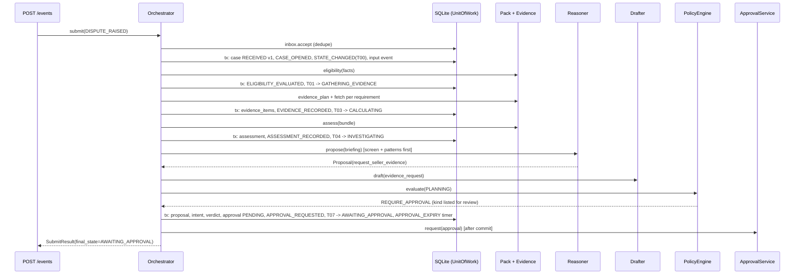
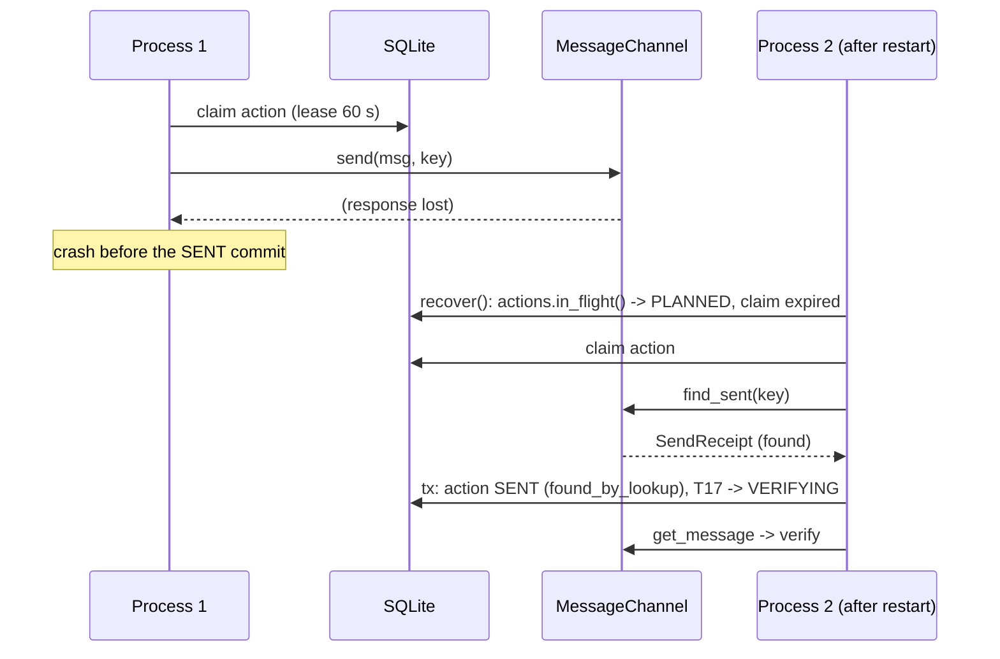

# Orchestrator (Stage A1)

Status: draft for owner approval. Implements `docs/FLOW.md` section 3 with the changes listed in `transitions.yaml` (`discrepancies`). Interfaces: `kernel-interfaces.md` section 10.

Plain-language summary: the orchestrator is the loop that moves a case forward. It works in **steps**. A step looks at the case, does its work (fetch evidence, ask the reasoner, send an email), and then saves one state change and everything that goes with it in a single database transaction. If anything goes wrong before that save, nothing is saved and the step can safely run again. A case keeps taking steps until it reaches a state where it has to wait (for the seller, operations, an approver or a human) or it is finished.

## 1. Vocabulary

| Term | Meaning |
|------|---------|
| Step | One unit of work for one case: read, compute, (maybe) call a port, then commit exactly one transition or a `rest`. Steps are named in `transitions.yaml` (`steps`). |
| Step transaction | The single `UnitOfWork` in which a step commits. It saves the case with `expected_version`, appends events, and writes every row the step produced. |
| Resting state | A state in which `advance` stops: `waiting`, `human`, `terminal`, or `VERIFYING` / `AWAITING_SELLER` when their step returns `rest`. |
| Reaction | What a state does with an inbound event: transition, step, absorb, defer, ignore (`transitions.yaml` `accept`). |
| Runner | The single background loop (section 6) that fires timers, retries inbox rows, advances stuck cases, delivers outcomes and approval notifications. |

Three rules hold for every step:

1. **External calls happen outside the transaction.** A step reads (short read transaction or plain reads), calls ports, then opens the step transaction to write. A slow model or email call never holds the database lock.
2. **One commit per step, guarded by the case version.** The step transaction always saves the case row with `expected_version` (even when only a counter changes), so two workers cannot both commit a step for the same case.
3. **Absorb, defer and ignore never touch the case row.** They append events and update the inbox only. So a reply that arrives while an email is being sent cannot conflict with the send step.

## 2. Intake: `submit(event)`

```python
def submit(event: InboundEvent) -> SubmitResult:
    validate_shape(event)                                  # 422 on failure; nothing stored
    with uow() as tx:
        try:
            inbox_id = tx.inbox.accept(event, clock.now()) # UNIQUE dedupe_key
        except DuplicateEvent as dup:
            return SubmitResult(inbox_id=dup.existing_inbox_id, duplicate=True, ...)
    case_id = dispatch(inbox_id)
    final = advance(case_id, ...) if case_id else None
    return SubmitResult(inbox_id=inbox_id, duplicate=False, case_id=case_id, final_state=final)
```

Routing (inside `dispatch`, section 3.1) finds the case:

| Event | Routing rule |
|-------|--------------|
| `DISPUTE_RAISED` | 1. `find_open(shipment, claim)` -> that case (the matrix absorbs it). 2. Else `find_latest`: if it is soft-terminal, not superseded, and `now < closed_at + reopen_window_days` -> that case (the matrix reopens it or sends it to review). 3. Else open a **new case** (T00) with `prior_case_id = latest.id` when a latest case exists; mark the latest `superseded_by_case_id = new.id` in the same transaction. |
| `SELLER_REPLY_RECEIVED` | `messages.case_for_conversation(conversation_id)`; else exactly one open case whose `seller_contact` equals the sender and whose `shipment_ref` appears in the subject; else `UNROUTABLE`. |
| `DELIVERY_FAILURE_RECEIVED` | the case of the outbound message with `external_message_id = failed_external_message_id`; else `UNROUTABLE`. |
| `OPS_FINDING_RECEIVED` | the action whose idempotency label is on the issue -> its case; else `UNROUTABLE`. |
| `DISPUTE_WITHDRAWN` | `find_open(shipment, claim)`; else `UNROUTABLE`. |
| others | `event.case_id` (required at intake); unknown id -> `UNROUTABLE`. |

A new case is created in RECEIVED at version 1, with `CASE_OPENED` and `STATE_CHANGED(T00)` events and the `DISPUTE_RAISED` input event, all in one transaction. The two-open-cases race is settled by the unique partial index: the loser gets `ConcurrencyConflict`, re-runs routing, finds the winner's case and absorbs.

## 3. Dispatch and advance

### 3.1 `dispatch(inbox_id)`

```python
def dispatch(inbox_id: InboxId) -> CaseId | None:
    for attempt in range(settings.concurrency_retries):            # default 3
        entry = read(inbox_id)
        if entry.status in (PROCESSED, UNROUTABLE): return entry.case_id
        try:
            with uow() as tx:
                case = route(tx, entry)                            # section 2; may create the case
                if case is None:
                    tx.inbox.mark(inbox_id, UNROUTABLE); return None
                event = entry.event_id and tx.events.get(entry.event_id) \
                        or tx.events.append(as_input_event(entry, case))   # appended once, ever
                reaction, arg = pre_dispatch_rules(case, entry) \
                                or machine.reaction(case.state, entry.event)
                match reaction:
                    case ABSORB:  tx.inbox.mark(inbox_id, PROCESSED, case_id=case.id, event_id=event.id)
                    case IGNORE:  tx.events.append(event_ignored(...)); tx.inbox.mark(..., PROCESSED)
                    case DEFER:   tx.events.append(event_deferred(...)); tx.inbox.mark(..., DEFERRED)
                    case TRANSITION: commit_transition(tx, case, Trigger(arg), event, ...)   # with "a | b" fallback
                                     tx.inbox.mark(..., PROCESSED)
                    case STEP:    pass                              # handled after commit, below
            if reaction is STEP:
                result = run_step(case.id, step=arg, input_event=event)   # its own step transaction
                if result.moved: continue                          # case changed state first: re-evaluate the
                                                                   # reaction against the new state (never drop it)
                mark_processed(inbox_id)                           # separate small txn; idempotent
            redeliver_deferred(case.id)                            # section 3.4
            return case.id
        except ConcurrencyConflict:
            continue
    schedule_inbox_retry(inbox_id)                                 # attempts += 1, next_attempt_at = backoff
    return None
```

For a `TIMER_FIRED` event, every reaction except DEFER also calls `timers.consume(timer_id)` in the same transaction, so P1 can tell "fired, waiting in the inbox" (valid) from "already handled" (stale).

Pre-dispatch rules (`transitions.yaml` P1-P4) run before the matrix: stale timer, stale approval, non-human actor on a human event, superseded case. Each produces `IGNORE` with its reason. Two more checks run here because they need the case: a `DISPUTE_WITHDRAWN` whose principal is not the case's seller, and an `APPROVAL_DECIDED` whose `payload_hash_seen` differs from the approval's, are ignored with `principal_mismatch` / `payload_hash_mismatch`.

If a STEP reaction's step raises `ConcurrencyConflict` after retries, the inbox row stays `PENDING` with a retry time and the event is already appended; the runner dispatches it again, which re-evaluates the reaction against the case's current state (the event is not appended twice: `entry.event_id` is set).

### 3.2 `advance(case_id)`

```python
def advance(case_id, correlation_id, causation_id) -> CaseState:
    for _ in range(settings.max_steps_per_advance):                # default 12
        case = read_case(case_id)
        if case.category not in (AUTO, AUTO_MAY_REST): return case.state
        result = run_step(case_id, step=STATE_STEP[case.state])
        if result.rested: return case.state                        # VERIFYING waiting for read-back
    escalate(case_id, ReviewReason(code=STEP_LIMIT))               # a loop is a bug: fail safe
    return CaseState.NEEDS_HUMAN_REVIEW
```

Twelve steps is enough for the longest legal automatic run (RECEIVED -> GATHERING -> CALCULATING -> INVESTIGATING -> EXECUTING -> VERIFYING -> EXECUTING (follow-up) -> VERIFYING -> outcome is 8).

### 3.3 `run_step(case_id, step)`

```python
def run_step(case_id, step, input_event=None) -> StepResult:
    for attempt in range(settings.concurrency_retries):
        case = read_case(case_id)
        if STATE_STEP.get(case.state) != step and step not in EVENT_STEPS[case.state]:
            return StepResult(rested=True, moved=True)             # someone else moved the case
        try:
            with tracer.span(f"step.{step}", case_id=case.id):
                work = STEPS[step].compute(case, input_event)      # reads + port calls; no writes
            with uow() as tx:
                STEPS[step].commit(tx, case, work)                 # writes + exactly one transition or rest
            after_commit(work)                                     # approval notify, outcome delivery
            return work.result
        except ConcurrencyConflict:
            continue
        except KernelError as err:                                 # mapped per kernel-interfaces.md section 5
            return escalate(case_id, map_error(err), cause=step)
        except Exception as err:                                   # a bug inside a step
            log.exception("step_failed", step=step)
            return escalate(case_id, ReviewReason(code=INTERNAL_ERROR, detail=type(err).__name__), cause=step)
    raise ConcurrencyConflict(case_id, case.version)               # caller schedules a retry
```

`escalate` is itself a step transaction applying T90 (re-read, version-checked, retried). If the case is already in NEEDS_HUMAN_REVIEW or terminal, `escalate` does nothing (X13).

### 3.4 Deferred redelivery

After any transaction that changed the case's state, `redeliver_deferred(case_id)` loads the case's `DEFERRED` inbox rows oldest first and dispatches each whose reaction in the current state is not `defer`, skipping (not stopping at) rows that are still deferred. It repeats until a pass dispatches nothing, because each dispatch may change the state. Events of the **same type** keep their arrival order (a reply never overtakes an earlier reply); events of different types may overtake, so a deferred reply in AWAITING_OPS does not hold back a `DISPUTE_WITHDRAWN` for up to 120 h.

### 3.5 The steps

Each row: what the step computes outside the transaction, then what the step transaction writes. Events are appended in the order shown.

| Step (state) | Compute (no writes) | Commit: rows, events, trigger |
|--------------|---------------------|-------------------------------|
| `eligibility` (RECEIVED) | `pack.eligibility(case.facts)` | `ELIGIBILITY_EVALUATED`; eligible -> T01 (also `gather_round += 1`, `rejection_count = 0`); ineligible -> T02; unknown -> escalate(`eligibility_unknown`) |
| `gather_evidence` (GATHERING_EVIDENCE) | `round = case.gather_round`; for each requirement in `pack.evidence_plan(facts)`: `evidence_sources[req.source].fetch(...)` (a missing source name or `ModuleUnavailable` -> a FAILED result with `error_code = module_unavailable:evidence`); for each unread inbound reply: `reply_interpreter.interpret(...)` -> an AI_DERIVED item (interpreter unavailable -> a FAILED item `module_unavailable:<module>`) | `evidence_items` rows, `messages.interpreted_round` set, `EVIDENCE_RECORDED`; T03 |
| `assess` (CALCULATING) | first, a kernel rule: if any **required** evidence item is FAILED with `error_code` `module_unavailable:<m>`, escalate `module_unavailable:<m>` without assessing (I6 does not depend on the reasoner); otherwise `pack.assess(case.id, round, bundle)` | `assessments` row, `ASSESSMENT_RECORDED`; ineligible -> T05; else T04 |
| `investigate` (INVESTIGATING) | 1. screen every untrusted text of the round (`InputScreen`); any `blocked` -> escalate(`guardrail_blocked`). 2. `patterns = pattern_context.patterns_for(facts)` (HOOK A). 3. build the briefing. 4. `reasoner.propose(briefing)`, with the fallback rules of section 5. 5. signals (HOOK B). 6. proposal -> intent (section 3.6). 7. `policy.evaluate(PLANNING)`. | `INPUT_SCREENED`*, `PATTERN_CONTEXT_LOADED`, [`REASONER_FALLBACK`], `PROPOSAL_RECORDED`, [`INTENT_CREATED`], `POLICY_EVALUATED`; then by verdict: ALLOW -> `executor.plan` (`POLICY_EVALUATED` stage EXECUTION, `ACTION_PLANNED`) -> T06; REQUIRE_APPROVAL -> approval row, `APPROVAL_REQUESTED` -> T07; wait -> T09 or escalate(`wait_without_expectation`; `reply_unresolved` after a seller reply); escalate_to_human -> escalate(`proposal_escalated`); ESCALATE/DENY -> escalate(verdict reason) |
| `execute` (EXECUTING) | claim the action (executor.md section 3); `executor.execute(action)` | action row update; for a message, an OUT `messages` row; `ACTION_SENT` -> T17; failed -> `ACTION_FAILED` -> escalate(`action_failed`); unknown -> `ACTION_UNKNOWN` -> escalate(`action_unknown`); kill switch -> `ACTION_FAILED(kill_switch_active)` -> escalate(`kill_switch_active`); `blocked(claimed_elsewhere)` -> no commit, **rest** (another worker holds the action; the stuck-case sweep retries) |
| `verify` (VERIFYING) | `executor.verify(action)`; if verified and kind is `credit`: build the `credit_confirmation` intent (FOLLOW_UP) and evaluate policy | verified: `ACTION_VERIFIED` -> T18/T19/T20/T21/T24/T25, or for a credit: `INTENT_CREATED`, `POLICY_EVALUATED`, then T23 (plan) / T22 (approval) / escalate(`follow_up_denied`). pending: `VERIFICATION_PENDING`, VERIFY_RETRY rescheduled, **rest**. failed: action -> UNKNOWN, `ACTION_UNKNOWN` -> escalate(`verification_failed`) |
| `reminder` (AWAITING_SELLER, on SELLER_REMINDER) | draft the reminder (TIMER intent); policy | ALLOW -> plan -> T28; REQUIRE_APPROVAL -> T27; ESCALATE/DENY -> `REMINDER_SKIPPED`, **rest** |
| `apply_approval` (AWAITING_APPROVAL, on APPROVAL_DECIDED) | — | `approvals.decide`; approved -> `executor.plan` (stage EXECUTION, consumes the approval) -> T10, or `PolicyRefused` -> escalate(`policy_denied`); rejected -> intent REJECTED, then T11 (proposal, under cap) / T12 (reminder) / escalate(`follow_up_rejected` or `approval_rejected_limit`) |
| `hand_off` (NEEDS_HUMAN_REVIEW, on HUMAN_TOOK_CASE) | if `notify_seller`: draft the `handed_to_human_notice` (FOLLOW_UP); policy | no notice -> T33; ALLOW -> plan -> T35; REQUIRE_APPROVAL -> T34; ESCALATE/DENY -> `NOTICE_NOT_SENT` -> T36 |

Transitions caused directly by events (T13-T16 from the matrix, T26, T29-T32, T37-T48, T90 with event reasons; T10-T12 come from the `apply_approval` step) are committed in `dispatch` by `commit_transition`, which applies `machine.decide` + `machine.apply` + effects in the dispatch transaction. `HUMAN_RETURNED_CASE` additionally applies each `unknown_action_resolutions` entry (action UNKNOWN -> VERIFIED with `verified_by = human:<id>`, or FAILED with `last_error_code = human_confirmed_not_done`) and writes `UNKNOWN_ACTION_RESOLVED`, before T37's guard `unknown_actions_resolved` is checked.

### 3.6 From proposal to intent

| Proposal action | Intent | Payload source | Notes |
|-----------------|--------|----------------|-------|
| `request_seller_evidence` | SEND_MESSAGE `evidence_request`, or `clarification_request` when this gather round contains a seller reply (owner decision D19) | `drafter.draft(DraftContext(kind, assessment facts, requested_items))`; on `ModuleUnavailable` or a transient error, `pack.render_template`. A clarification names what is still missing or unclear: the `requested_items_status` entries that are `missing`/`partial` plus the proposal's `missing_evidence` / `conflicting_evidence` findings | `to` is always `case.facts.seller_contact`. A draft with `blocked_reason` -> escalate(`policy_escalated`, detail `draft_blocked`). A second clarification on the case (over `policy.contact.max_clarifications_per_case` = 1) is denied -> escalate(`reply_unresolved`). |
| `uphold_charge` | SEND_MESSAGE `upheld_explanation` | same | |
| `request_remeasurement` | UPSERT_ISSUE `remeasurement` | code builds summary and description from facts; the proposal's `remeasurement_question` is model output and goes inside a delimited "Investigator question" block | no AI-written text outside the block |
| `propose_credit` | POST_CREDIT | `amount = assessment.discrepancy`; `reason_code = action_parameters.reason_code`; `fact_ids` = the facts the discrepancy came from | the amount never comes from model output (I9). No discrepancy -> escalate(`policy_escalated`, detail `no_amount`). A2 `money-rules.md` refines the derivation. |
| `wait` | none | — | policy still evaluates (intent None) so limits and kill switch are recorded. After a seller reply it is always denied -> escalate(`reply_unresolved`): an unclear reply gets a clarification or a person, never a silent wait (D19) |
| `escalate_to_human` | none | — | escalate(`proposal_escalated`) |

Reminders, credit confirmations and hand-off notices are built by code (TIMER / FOLLOW_UP intents), drafted the same way as messages above.

Kernel rule on the menu: when the case (or any case for the same shipment and reason) has a live or verified credit, the briefing's `allowed_actions` excludes `propose_credit` and `uphold_charge`. A reopened credited case can ask for evidence, request a remeasurement, wait or escalate; it can never tell the seller the charge stands after money moved, and never credit twice.

`after_commit` also calls `ApprovalService.withdraw` for every approval the transaction marked SUPERSEDED or EXPIRED, so stale items leave the review queue (idempotent; failures are retried by the runner).

## 4. Concurrency

- **Single writer, optimistic versions.** SQLite has one writer at a time; `BEGIN IMMEDIATE` makes every step transaction take the lock at the start. The version check protects the gap between "read the case" and "commit the step", during which the step did slow work (model calls, HTTP).
- **Conflict handling.** `ConcurrencyConflict` re-reads the case and re-runs the step from the start, up to `orchestrator.concurrency_retries` (3) times. Nothing external is repeated unsafely: model calls are side-effect free (they cost money, which `model_calls` records), and the only external writes happen in `execute`, which is protected by the action claim and lookup-before-write (executor.md section 3).
- **After retries are exhausted** the inbox row is scheduled for retry (`next_attempt_at = now + min(2^attempts, 300) s`); after 10 attempts it is marked `FAILED` and logged at ERROR. A case left in an auto state is picked up by the runner's stuck-case sweep. A conflict never sends a case to human review: it is not a property of the case.
- **Within one process**, an in-memory per-case lock serialises `advance` calls for the same case, so the common case (a reply arriving while a timer fires) never even conflicts. The database checks make a second process safe; v1 runs one worker process (ADR 0008).

## 5. Module availability, fallbacks and errors

| Situation | Where detected | Result |
|-----------|----------------|--------|
| A write module (email, ticketing, ledger) disabled | policy (module availability rule, from `ModuleStatus`) at planning; `Disabled` adapter raises `ModuleUnavailable` if reached anyway | escalate `module_unavailable:<module>` (I6). Investigation before the send step still runs (FLOW section 7). |
| `approvals` disabled and the intent needs review | policy at planning | escalate `module_unavailable:approvals` |
| `ApprovalService.request` raises `ModuleUnavailable` after the AWAITING_APPROVAL commit | `after_commit` | an escalate step with `module_unavailable:approvals` |
| `ApprovalService.request` transient failure | `after_commit` | `approvals.notified_at` stays null; the runner retries; the case waits (the approval row is already the record) |
| `reasoning` or `model_gateway` unavailable (`ModuleUnavailable`, `TransientPortError` after the gateway's own retries) | investigate | `REASONER_FALLBACK`; `pack.baseline_proposal(briefing)` with `fallback_used = True`. The baseline decides clear cases; otherwise it returns `escalate_to_human` and the review reason is `module_unavailable:reasoning` (or `model_gateway`) (FLOW section 7) |
| `InvalidModelOutput`, `BudgetExceeded`, `GuardrailBlocked`, `AgentDrift` from the reasoner, interpreter or drafter | investigate / gather / drafting | escalate with that code. No fallback (FLOW section 7b). |
| `input_screen` disabled | investigate | no flags; a `screen_flag` caution signal with reason `screen_unavailable` (min REQUIRE_APPROVAL), so losing the screen adds caution |
| Evidence source disabled or failing | gather_evidence | FAILED evidence item with the code; `assess` and the reasoner see it; a required item that is FAILED makes the baseline escalate |
| `cross_case` disabled | — | Null adapter: no patterns, no signal |
| `cross_case` enabled but `patterns_for` raises | investigate | no patterns, `pattern_context_unavailable` signal (min REQUIRE_APPROVAL) |
| `tracing` disabled | — | no-op tracer; behaviour unchanged |
| Kill switch engaged | policy (planning) and inside `executor.plan` and `executor.execute` (I10) | escalate `kill_switch_active`. The case is not lost: a human returns it (T37) after the switch is released. |

## 6. Timers and the runner

Timers are rows; nothing sleeps in memory. Entering a state arms timers through transition effects; leaving cancels them (`transitions.yaml` gives the exact lists, and the due-time rules in `timer_kinds`).

The runner is one loop in the API process (`app.py` starts it; tests call `tick()` directly with a fake clock):

```python
def tick() -> None:                     # every runner.tick_seconds (default 5)
    timers.fire_due()                   # mark fired + TIMER_FIRED inbox row (dedupe scheduler:<timer_id>) in one txn; then dispatch
    dispatch_due_inbox()                # PENDING rows whose next_attempt_at <= now
    advance_stuck_cases(older_than=60)  # cases in AUTO states not updated for 60 s
    resume_verifications()              # VERIFYING cases whose VERIFY_RETRY fired are handled by dispatch; this catches lost ones
    notify_unnotified_approvals()
    outcomes.deliver_pending()          # HOOK C delivery
```

A timer that fires late (the process was down) still fires once, and the event carries its original `due_at`. A timer whose case has moved on is ignored by pre-dispatch rule P1 (it is cancelled, or `armed_at_version` no longer matches an active timer row).

## 7. Restart recovery: `recover()`

Run once at start-up, before the API accepts requests and before the first `tick`. Each step is idempotent, so a crash during recovery is followed by another recovery.

1. Validate configuration and the registry; check the SQLite version and pragmas; check the transition table (C1-C16). Any failure stops start-up.
2. **In-flight actions first** (`actions.in_flight()`): for each case in EXECUTING, run the `execute` step. It claims the action (an expired claim from the crashed process can be taken), looks up by idempotency key before writing, and only re-sends if the adapter makes that safe (executor.md section 5). For each case in VERIFYING, run `verify`.
3. Cases in other auto states (RECEIVED, GATHERING_EVIDENCE, CALCULATING, INVESTIGATING): `advance`. Their last step never committed, so re-running it is safe.
4. Inbox rows `PENDING`: `dispatch`. Rows `DEFERRED`: `redeliver_deferred` per case.
5. Due timers: `fire_due` (missed timers fire now).
6. Approvals with `notified_at` null: notify. Outcome outbox: deliver.
7. Write a structured log line `recovery_complete` with counts per step. Recovery events use a fresh correlation id (events-catalog.md section 4).

The Phase 1 restart test: drive a case to AWAITING_SELLER with a fake clock, drop every in-memory object, build a new app on the same SQLite file, advance the fake clock past 48 h, run `recover()` and `tick()`: the reminder step runs exactly once.

## 8. The three cross-case hooks

| Hook | Where | Until Phase 7 | Rule |
|------|-------|---------------|------|
| A: context in | `investigate`, before the briefing: `pattern_context.patterns_for(case.facts)` -> `briefing.pattern_context` | `NullPatternContextProvider` returns `()` | read-only port; failure adds a caution signal |
| B: caution out | `investigate`, before policy: `signals = kernel_signals(case, screens) + caution_signals_from(patterns, proposal, policy_config)` | patterns are empty, so only kernel signals (repeat dispute, screen flags) | a signal's `min_verdict` is REQUIRE_APPROVAL or ESCALATE; the verdict is a max, so signals only add caution (I7) |
| C: outcome out | transition effect `record_outcome` writes `CASE_OUTCOME_RECORDED` and an `outcome_outbox` row in the terminal transaction; `OutcomeDispatcher` delivers after commit and on every tick | `NullOutcomeObserver` does nothing; rows are marked delivered | at-least-once, observer idempotent on `outcome.id`; delivery failure never touches the case |

`caution_signals_from` lives in `kernel/policy/signals.py` and maps patterns to signals using thresholds from `policy.patterns` (config), so Phase 7 changes configuration and adapters, not kernel code. `CaseOutcome.used_pattern_ids` lists every pattern that appeared in any briefing of the case, which is what Phase 7 needs to avoid circular confirmation (FLOW section 6).

The two-pass anchoring control (FLOW section 6) lives inside the `llm` reasoner adapter: pass 1 receives the briefing with `pattern_context` removed, pass 2 the full briefing. The kernel sees one `Proposal`; `pattern_influence.changed_recommendation = true` becomes a `pattern_changed_recommendation` signal.

## 9. Sequence diagrams

### 9.1 New dispute to evidence request (pilot: every message reviewed)



### 9.2 Approval, send, verify, wait

```mermaid
sequenceDiagram
    participant Q as Review queue
    participant O as Orchestrator
    participant DB as SQLite
    participant X as ActionExecutor
    participant M as MessageChannel
    Q->>O: submit(APPROVAL_DECIDED approved, payload_hash_seen)
    O->>DB: tx: input event; apply_approval: approvals.decide
    O->>X: plan(intent, approval)  [inside tx]
    X->>X: policy.evaluate(EXECUTION), approval binding, kill switch
    X->>DB: action PLANNED (idempotency key), approval consumed, ACTION_PLANNED, T10 -> EXECUTING
    O->>X: execute(action)
    X->>DB: claim action (conditional UPDATE)
    X->>M: find_sent(key)  [lookup before write]
    M-->>X: None
    X->>M: send(msg, key)
    M-->>X: SendReceipt
    O->>DB: tx: action SENT, messages OUT, ACTION_SENT, T17 -> VERIFYING
    O->>X: verify(action)
    X->>M: get_message(receipt)
    M-->>X: snapshot (recipient, body hash, key)
    O->>DB: tx: action VERIFIED, ACTION_VERIFIED, T18 -> AWAITING_SELLER, SELLER_REMINDER + SELLER_DECISION timers
```

### 9.3 Crash during send, then recovery



## 10. Test ideas (Phase 1)

- `advance` on a fresh dispute with fakes reaches AWAITING_APPROVAL in exactly the transitions T00, T01, T03, T04, T07.
- Two concurrent `submit` calls for two different events of the same case (threads, file-backed SQLite) end with a consistent case and no lost event.
- A step that raises an unexpected exception leaves the case in NEEDS_HUMAN_REVIEW with `internal_error`, never in a half-written state.
- A conflict injected between compute and commit (fake repository raising once) re-runs the step and commits once.
- A reply arriving while the case is EXECUTING is deferred and processed after VERIFYING -> AWAITING_SELLER, in arrival order.
- With `email` disabled, a proposal to request evidence escalates with `module_unavailable:email` (FLOW section 7, Phase 1 acceptance).
- With `reasoning` disabled, a provable calculation error is still proposed by the baseline (fallback_used = True); an ambiguous case escalates with `module_unavailable:reasoning`.
- `max_steps_per_advance` exceeded (a test-only looping table) escalates with `step_limit`.
- The restart test in section 7.
- `PatternContextProvider` raising adds a `pattern_context_unavailable` signal and the verdict is at least REQUIRE_APPROVAL.
- The outcome outbox delivers once per outcome id; an observer that raises is retried and the case is unchanged.

## Appendix A. State machine checks run in Stage A1

The checks C1-C16 listed in `transitions.yaml` were run with a throwaway script against the table (49 transitions after owner decision D19 removed T08, 57 after expanding the escalation group, 16 states, 240 accept-matrix cells). All passed. To confirm that the script can fail, three deliberately broken copies of the table were checked: removing `intent_is_not_credit` from T06 failed C7 (and flagged T28 too); pointing T29 (silent seller) at RESOLVED_UPHELD failed C5; deleting the HANDED_TO_HUMAN row of the matrix failed C9. Phase 1 turns each check into a unit test over `kernel/statemachine/transitions.py`, plus a hypothesis test over random event sequences (no illegal state reachable; terminal states change only through T39-T48).

The schema (`schema.sql`) was loaded into an in-memory SQLite 3.45.1 database and 27 negative tests were run against it (illegal transition, version skip, events update and delete, duplicate dedupe key, credit action without approval, a second live credit for the same shipment and reason from another case, non-human approval, idempotency key reuse, illegal action status moves, two active timers of a kind, evidence value without FOUND, malformed timestamp, and more). The first run found a real defect: the action status trigger used `=` and `GLOB` on nullable columns, so under SQL three-valued logic an UNKNOWN action could be marked VERIFIED by the system. The trigger is now NULL-safe and all 27 pass.

An independent review (a separate agent given the documents, not the author's reasoning) then found four real defects, all fixed in this version: (1) an action left PLANNED by a failed commit could be followed by a second credit: T90 now marks PLANNED/SENT actions UNKNOWN, T37 requires them resolved, and `ux_actions_one_credit` allows one live credit per shipment and reason; (2) a decision timer deferred while a reminder was sent was later dropped as stale, stranding the case: timers now distinguish fired-but-deferred from consumed or voided; (3) a credited case could be returned to the agent and upheld: T37 needs `no_verified_credit` and the menu drops credit/uphold once a credit exists; (4) the executor pseudocode could re-send an email after a crash when the lookup lagged: `recovery_unconfirmed`. It also showed T08/T09 (`wait`) could never fire because replies cancelled the seller timers; expectation timers now survive re-evaluation, and check C14 (a concrete-path check, confirmed to fail on the old table) guards it. Medium findings fixed: execute lease and budget, `blocked` handling, an I6 kernel rule for missing required evidence, head-of-line blocking in redelivery, and nine cross-document mismatches.
